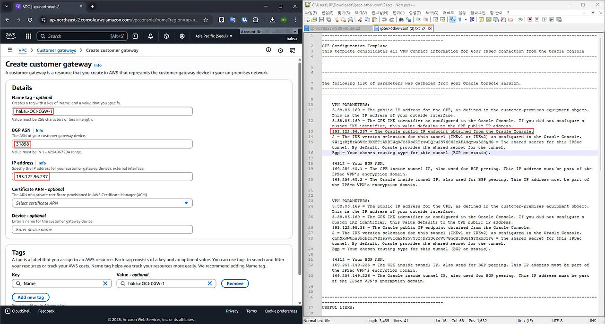
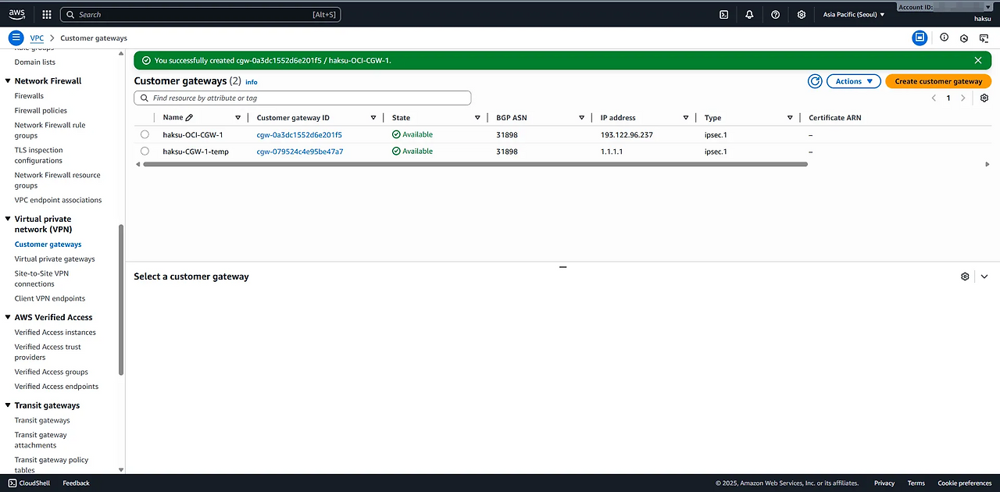
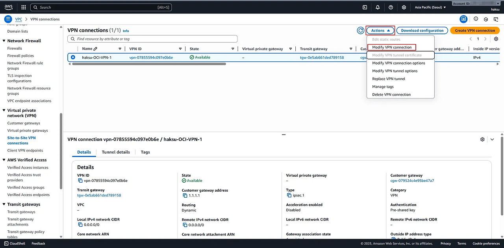
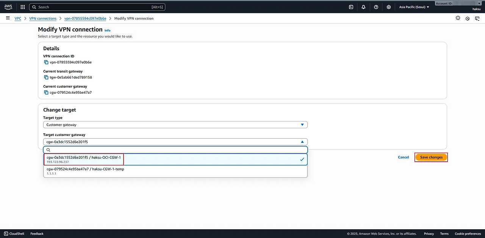
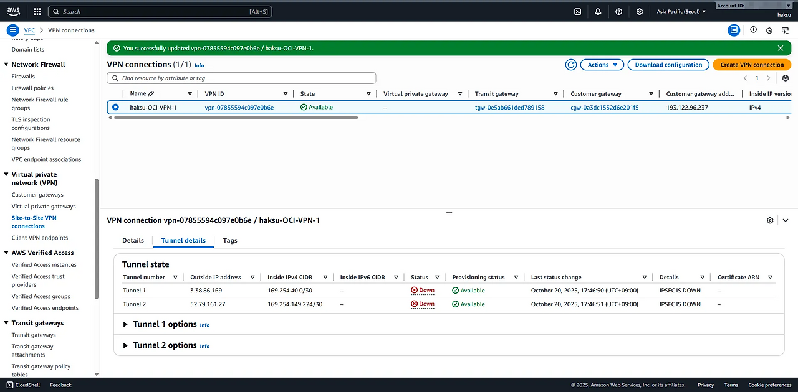
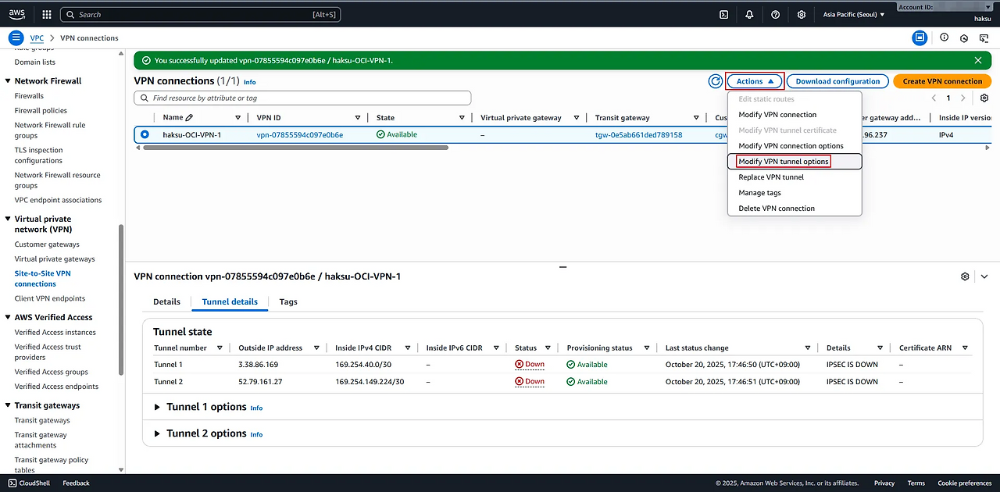
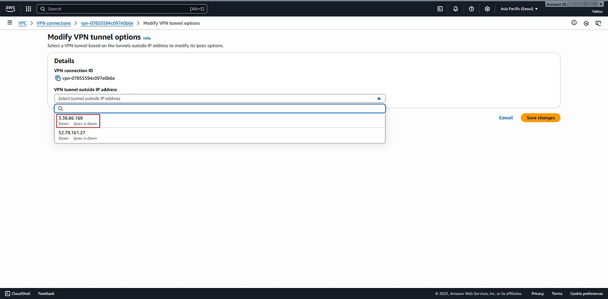
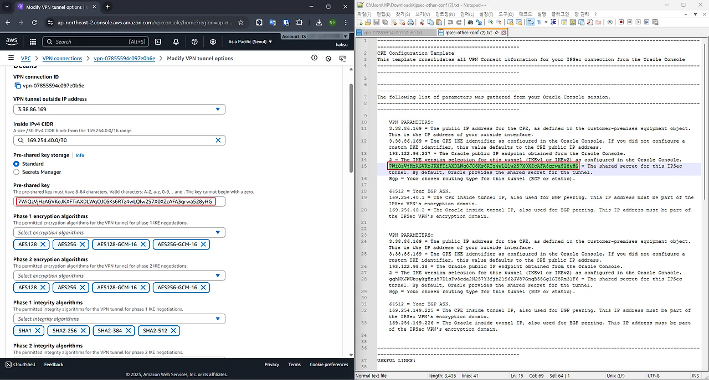
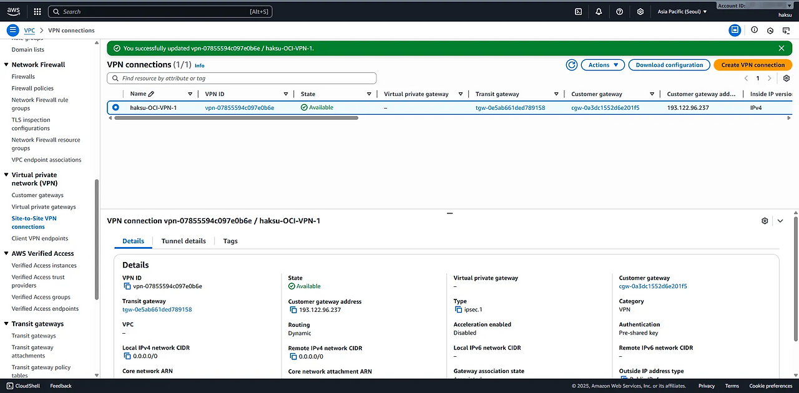

## 4.1. Customer gateway

### 4.1.1. OCI 측 tunnel IP를 가진 정식 Customer gateway 생성

1. Create customer gateway
- Name tag : \<적절한 이름 입력>
- BGP ASN : 31898
- IP address : \<OCI 측 tunnel IP 입력>

2. 생성 확인

### 4.1.2. VPN 구성 변경

1. 이전에 생성한 VPN 선택 → 우측 상단 Actions → Modify VPN connection 클릭

2. Target customer gateway 변경

3. 적용 확인

## 4.2. PSK (Pre-Shared Key) 변경

1. 생성한 VPN 우측 상단 → Actions → Modify VPN tunnel options 클릭

2. OCI 측과 연결한 tunnel 선택

3. OCI 측에서 할당받은 PSK로 변경

4. 적용 확인


**PSK(Pre-Shared Key) 일치**  
  
AWS 측과 OCI 측의 PSK 유효 조건이 다름  
 - AWS : 8~64자 / A~Z, a~z, 0~9, 언더바(\_), 점(.) / 0으로 시작 불가  
 - OCI : 1~255자 / 문자, 숫자, 공백  
    (https://docs.oracle.com/en-us/iaas/Content/Network/Tasks/overviewIPsec.htm#components)  
⇒ OCI 측에서 지원하는 유효 문자가 더 적음(특수문자 불가) → OCI PSK를 AWS에 맞춤\

