## 7.1. CPE

### 7.1.1. AWS 측 VPN tunnel 2 IP 확인

-   Virtual Private Gateway 항목 확인
-   OCI 측에서 CPE IP에 해당
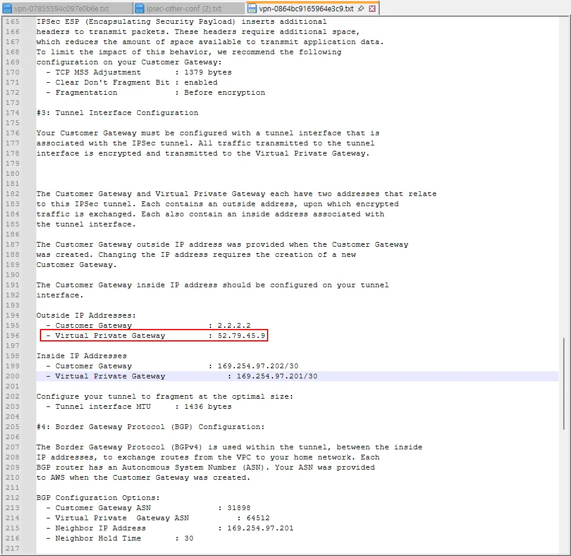

### 7.1.2. 설정

1. 내비게이션 메뉴 → Networking → Customer connectivity → Customer-premises equipment
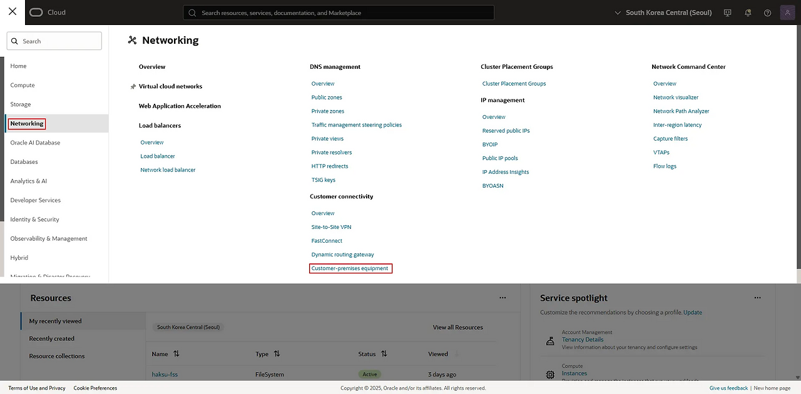

2. Create CPE
- Name : \<적절한 이름 입력>
- IP address : \<위에서 확인한 AWS 측 VPN tunnel 1 IP 입력>
- Vendor : Other
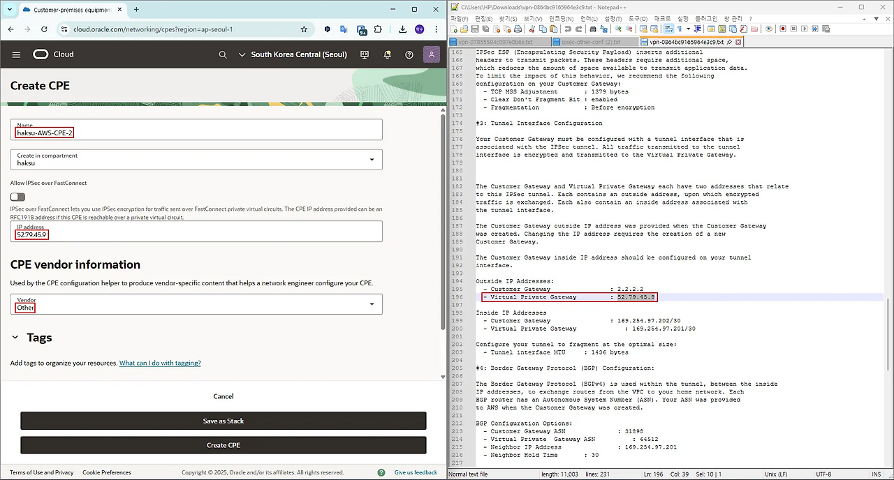

3. 생성 확인
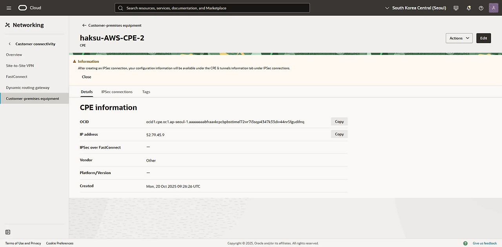

## 7.2. VPN

### 7.2.1. 기본 생성

1. 내비게이션 메뉴 → Networking → Customer connectivity → Site-to-Site VPN
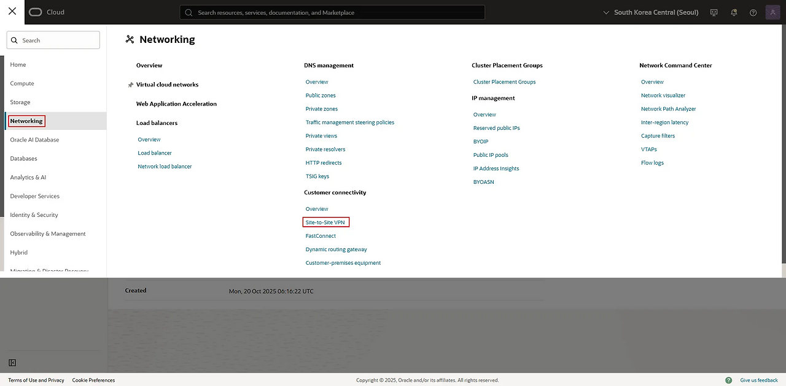

2. Create IPSec connection
- Name : \<적절한 이름 입력>
- Customer-premises equipment : \<위에서 생성한 CPE 선택>
- Dynamic routing gateway : \<OCI 측 네트워크에 Attach된 DRG 선택>
- Static routes to on-premises network : \<AWS 측 VPC Subnet CIDR 입력>
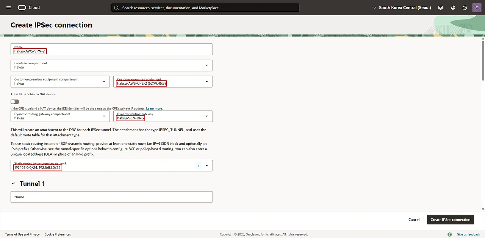

VPN을 BGP로 구성하는 경우, 해당 Static route to on-premises network 설정은 무시됨.  
BGP가 실패하고 Static으로 통신해야 할 때, VPN1과 이중화를 위해 CIDR 범위를 좁게 설정 (Longest prefix match rule)


### 7.2.2 tunnel 2 (+tunnel 1)

1. 기본 정보
- Name : \<적절한 이름 입력>
- IKE version : IKEv2 선택
- Routing type : BGP dynamic routing 선택
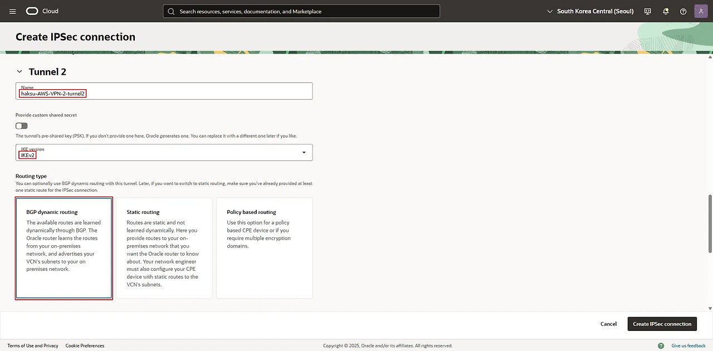

2. BGP 정보
- BGP ASN : \<AWS 측 ASN 입력>
- IPv4 inside tunnel interface - CPE : \<AWS 측 Virtual Private Gateway 항목 입력>
- IPv4 inside tunnel interface - Oracle : \<AWS 측 Customer Gateway 항목 입력>
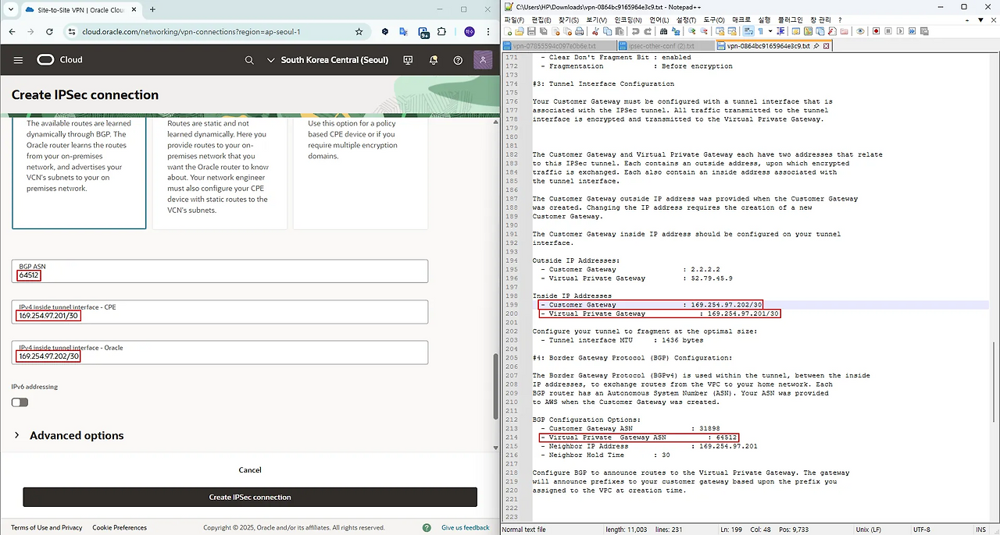

3. Phase 1 → AWS 측 정보와 일치
- Encryption algorithm
- Authentication algorithm
- Diffie-Hellman group
- IKE session key lifetime
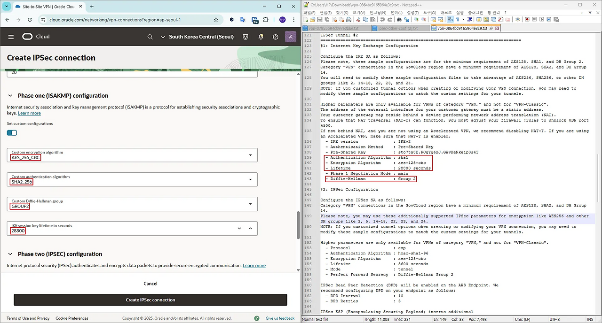

AWS에서 tunnel 알고리즘 정보를 변경하지 않고 Default로 생성한 경우, 위 Configuration 파일과 같이 Phase 별 알고리즘 정보가 하나만 표기 (실제 아래 사진과 같이 모두 체크되어 이용할 수 있으나 OCI 측에서 설정되어야 하는 알고리즘 정보를 오해하기 쉬움)  
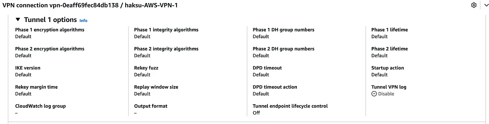
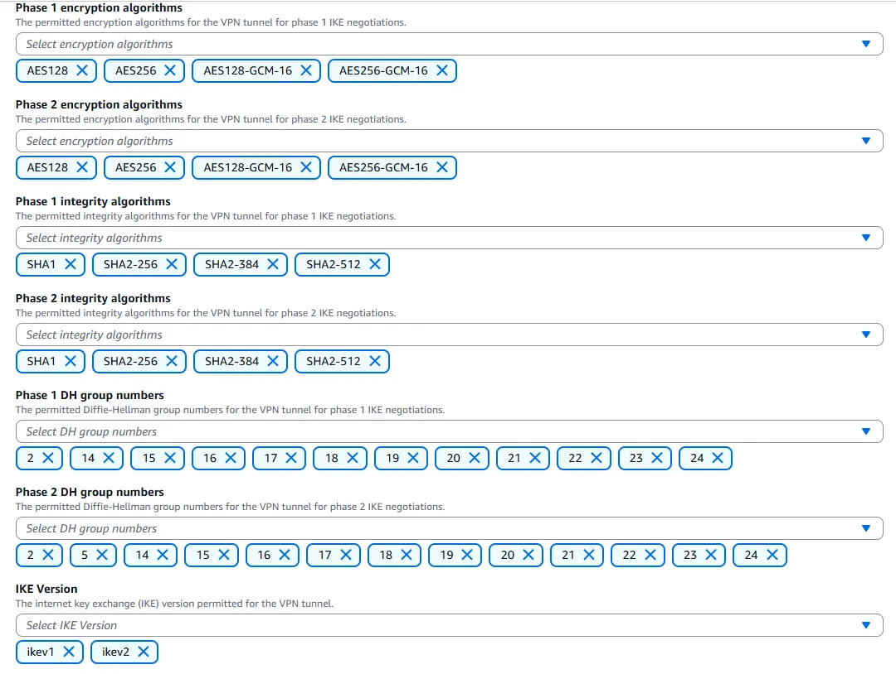


4. Phase 2 → AWS 측 정보와 일치
- Encryption algorithm
- IPSec session key lifetime
- Deffie-Hellman group
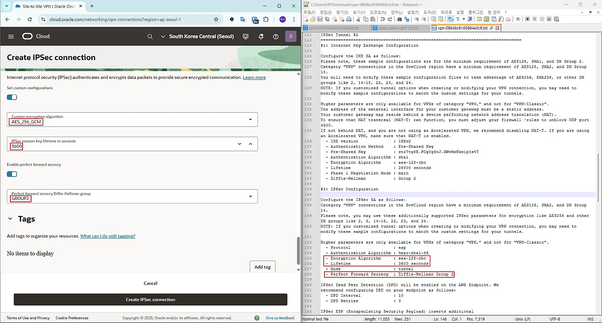

tunnel 1은 이용하지 않지만, 동일한 방법으로 구성


5. 생성 확인
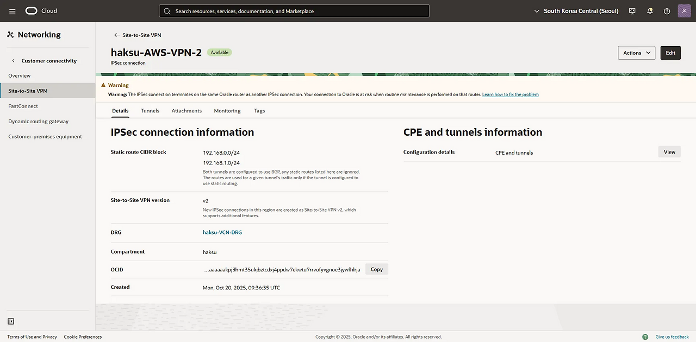

### 7.2.3. tunnel configuration

1. 생성한 tunnel 2 선택 → 우측 상단 Open CPE configuration helper 선택
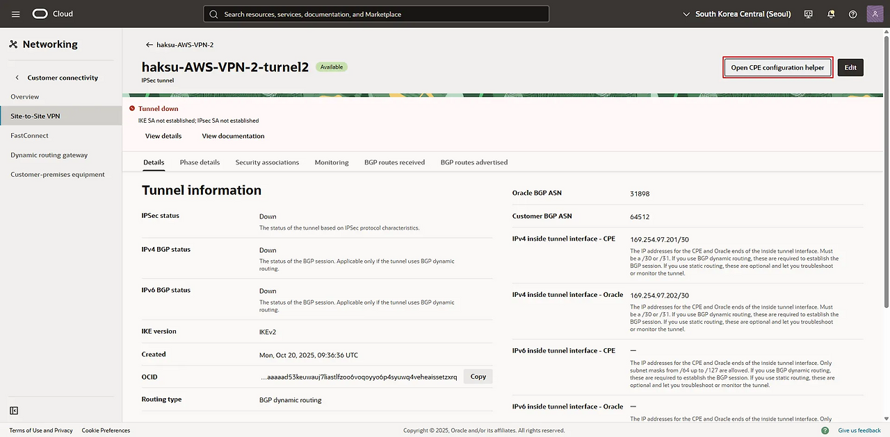

2. 우측 하단 Create content 선택
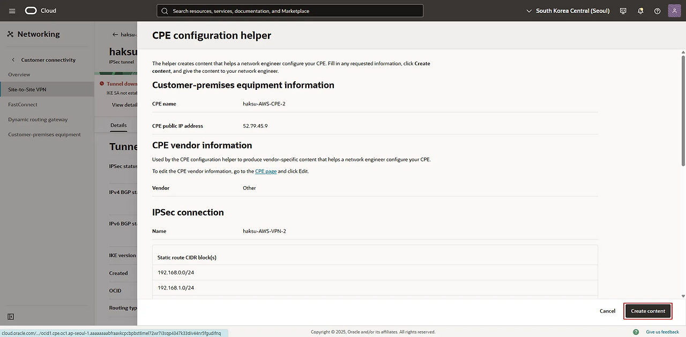

3. Download configuration 클릭
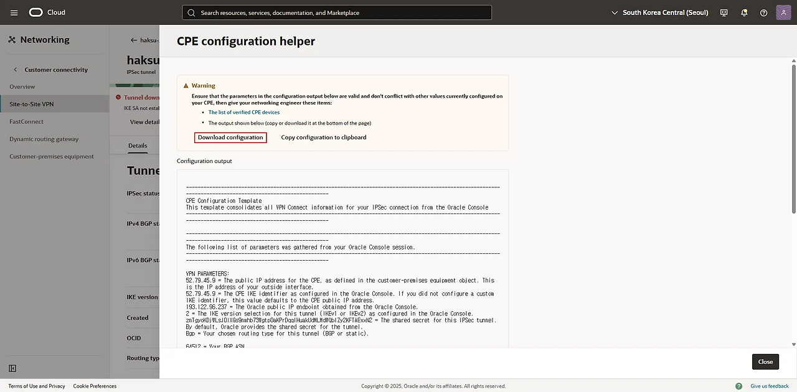

4. tunnel IP 및 PSK 확인
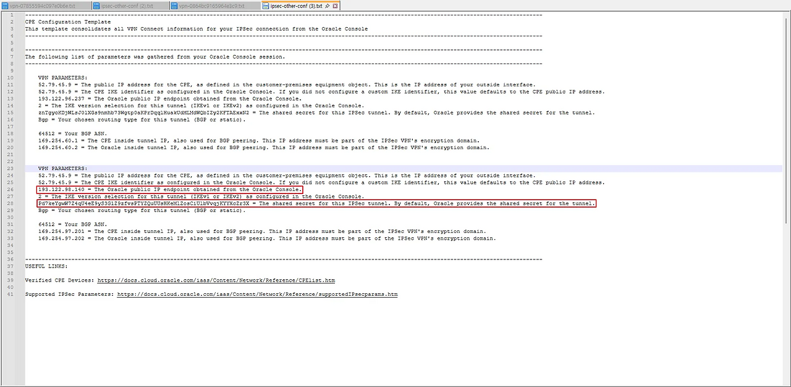
