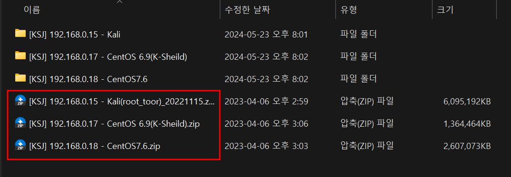
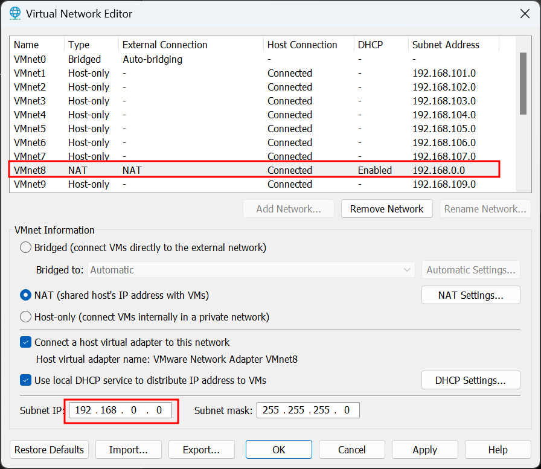
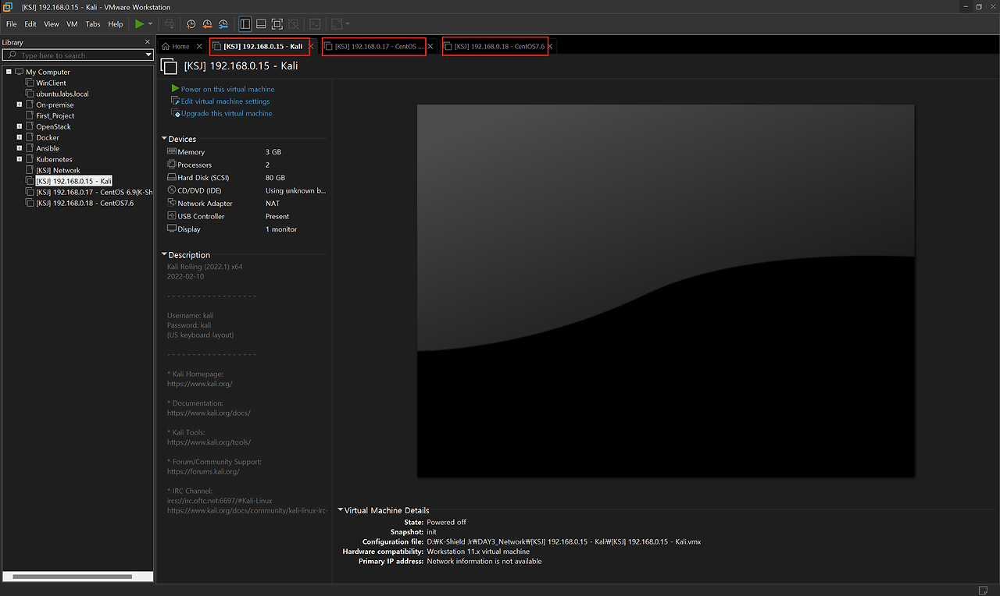
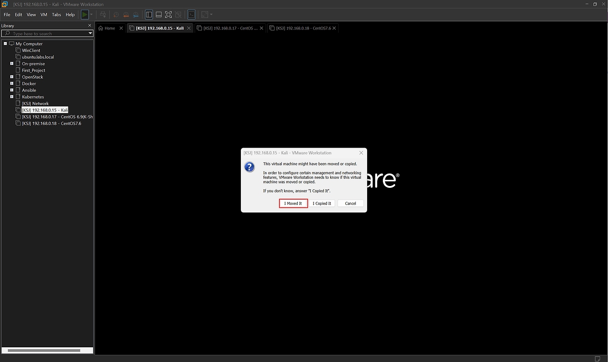
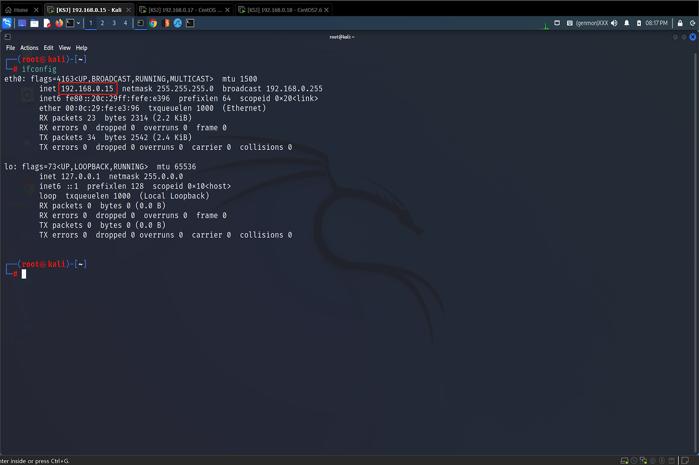
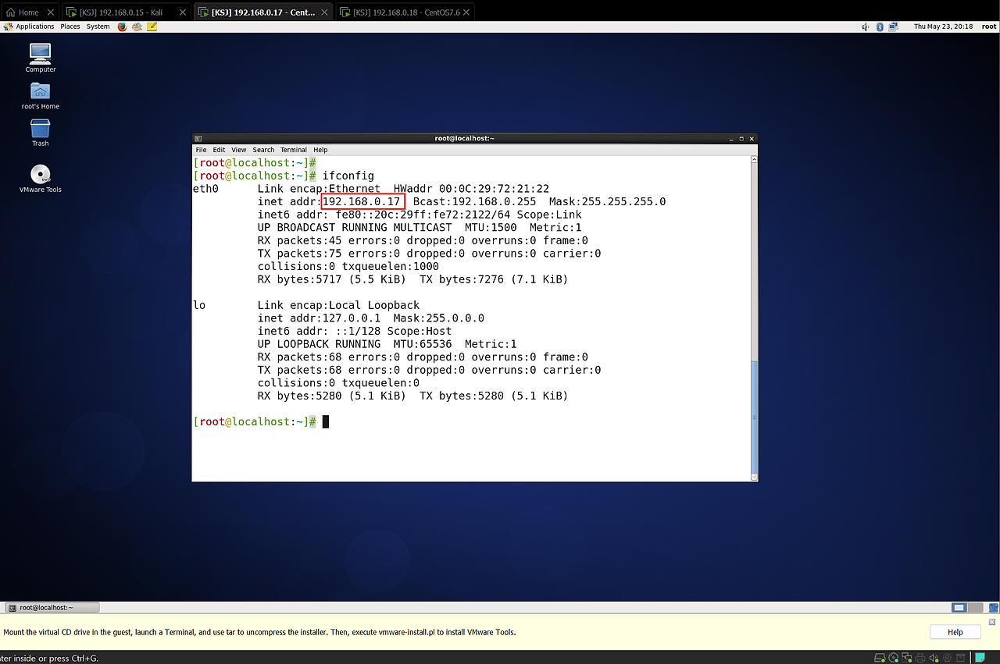
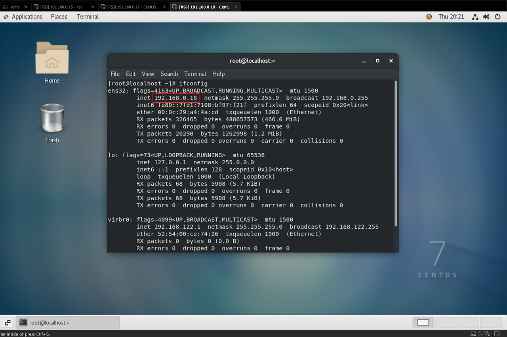

## 1. 압축 파일 해제
해당 파일들이 192.168.0.x  대역으로 설정되어 있기 때문에 VMware도 192.168.0.x 대역으로 맞춰줘야 한다.


VMware Player는 해당 기능이 없으니 vmnetcfg.exe 파일을 C:\\Program Files (x86)\\VMware\\VMware Workstation 경로에 복사 해서 설정  
(VMware Workstation Pro를 사용하는 경우는 Edit 탭 - Virtual Network Editor로 설정하면 됨)


## 2. VMware NIC 설정 및 가상 머신 실행
1. VMnet8 (NAT) IP 변경 
192.168.0.0 대역으로 설정

2. 모든 가상머신 실행

3. I Moved It 선택


VMware가 가상 머신의 위치 변경을 감지 했을 때 나타나는 메시지
-   I Moved It : VMware는 가상 머신이 다른 위치로 이동되었다고 가정하고, 가상 머신의 기존 설정을 유지
-   I  Copied It : VMware는 가상 머신이 복사되었다고 가정하고, 새로운 고유 식별자(UUID)를 할당하여 네트워크 충돌을 방지


## 3. 각 가상 머신(Kail, CentOS 6.9, CentOS 7) 내부 IP 확인
1. Kail IP 확인

2. CentOS 6.9 IP 확인

3. CentOS 7 IP 확인

