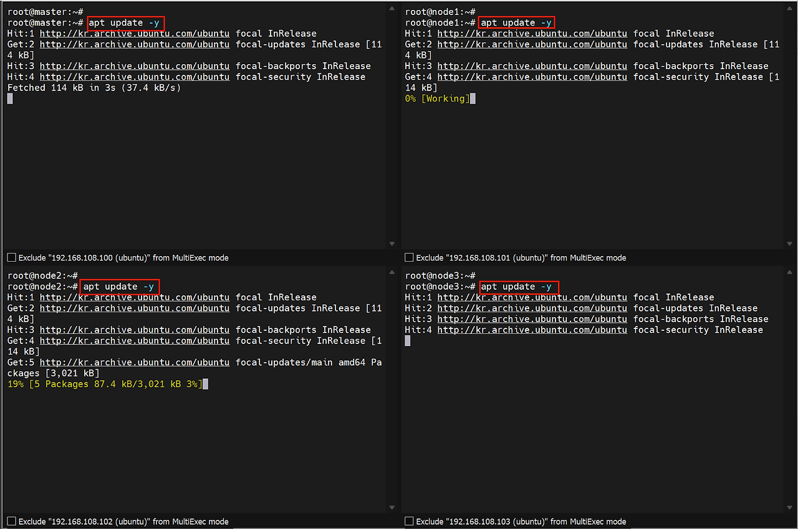
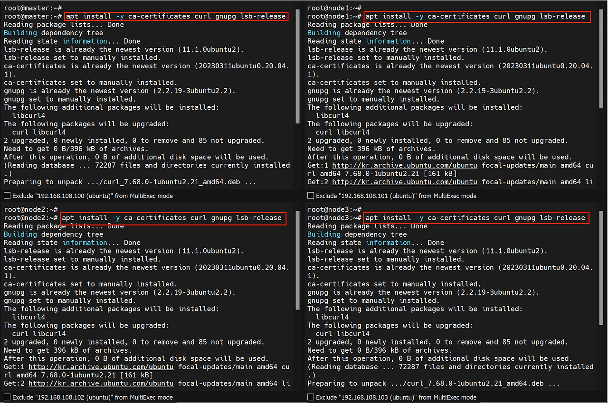
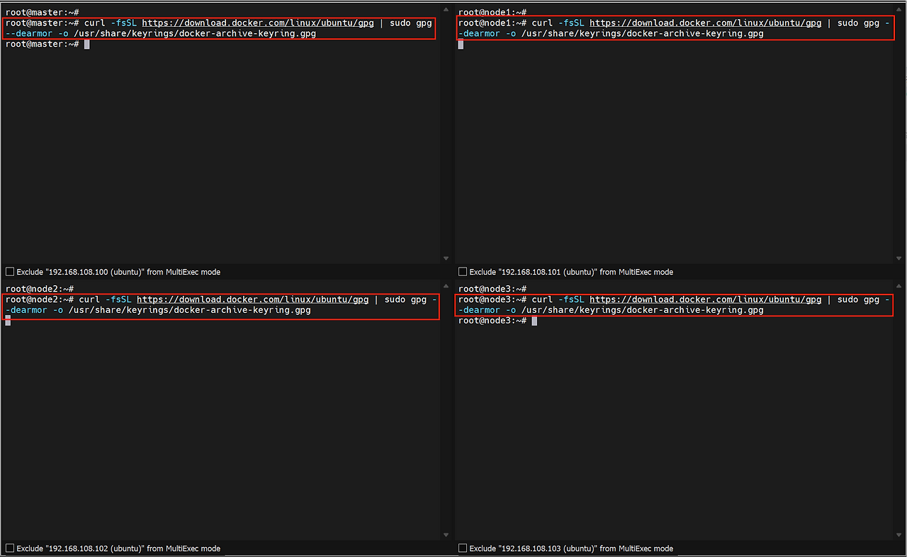
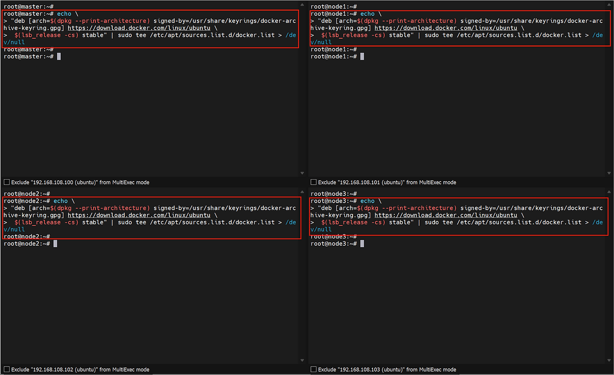
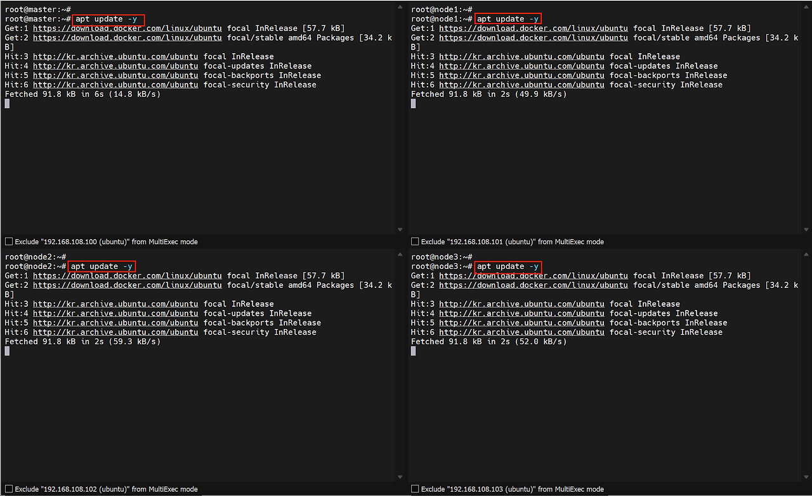
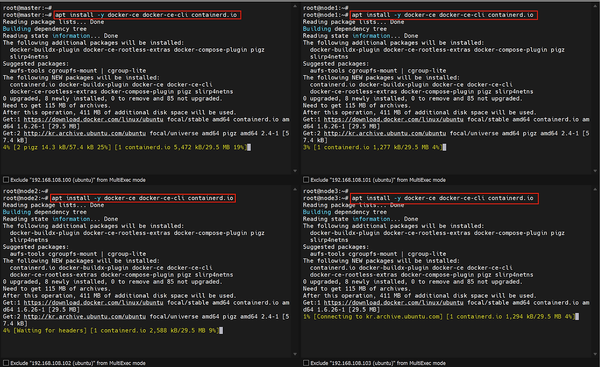
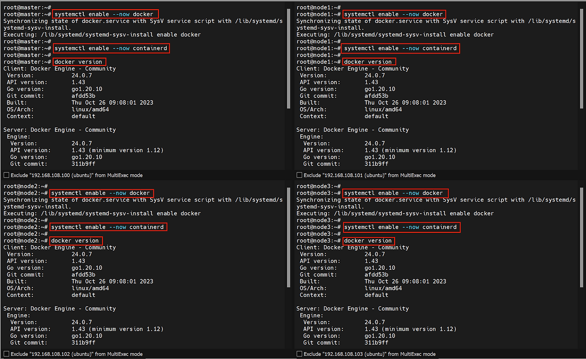
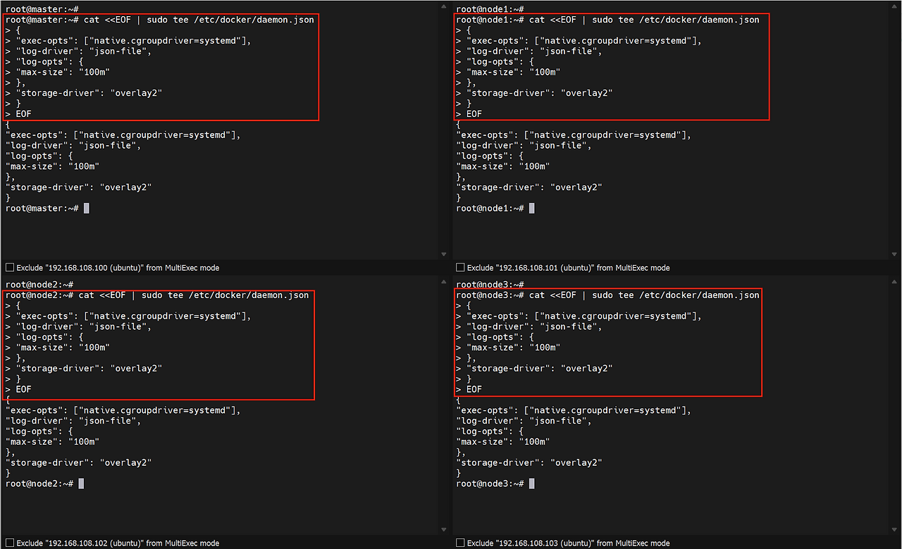
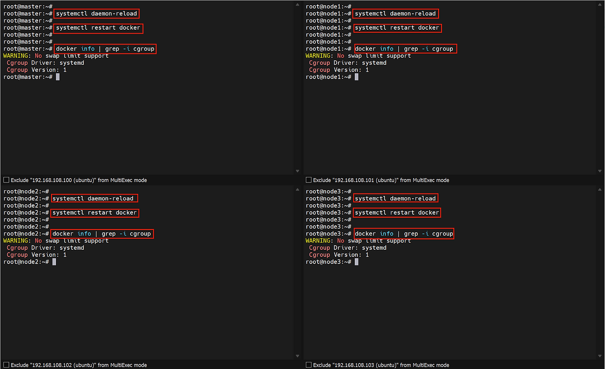

### 17. 도커 설치
1. apt update


2. ca-certificates, curl,  gnupg, lsb-release 패키지 설치


3. repository 추가 등록
비공식 repository로부터 패키지를 다운받아야 하기 때문에 인증키가 필요


    ```shell
    curl -fsSL https://download.docker.com/linux/ubuntu/gpg | sudo gpg -dearmor -o /usr/share/keyrings/docker-archive-keyring.gpg
    ```

4. k8s에 대한 기본 repository가 없기 때문에 인증키를 위해 추가


    ```shell
    echo "deb \[arch=$(dpkg --print-architecture) signed-by=/usr/share/keyrings/docker-archive-keyring.gpg\] https://download.docker.com/linux/ubuntu $(lsb\_release -cs) stable" | sudo tee /etc/apt/sources.list.d/docker.list > /dev/null
    ```

5. 인증키를 추가한 repository 경로를 다시 apt update


6. 도커 패키지 설치


7. 설치한 docker, containerd 데몬 활성화 후 docker 버전 확인


### 18. docker 설치 후, docker의 cgroup driver를 cgroupfs에서 systemd로 변경
데몬 재활성화, 재실행 후 cgroup driver systemd로 변경된 것 확인


