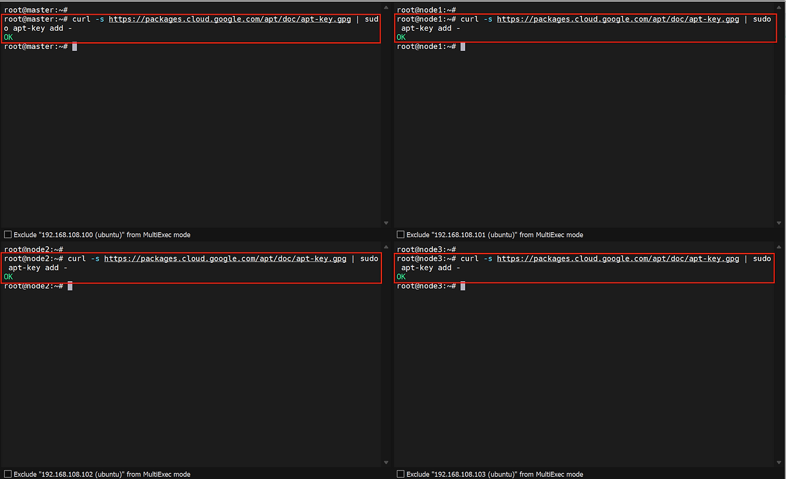
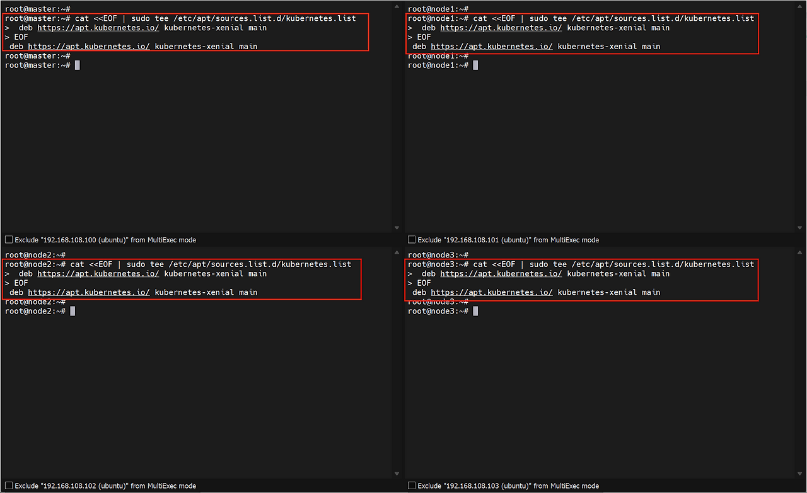
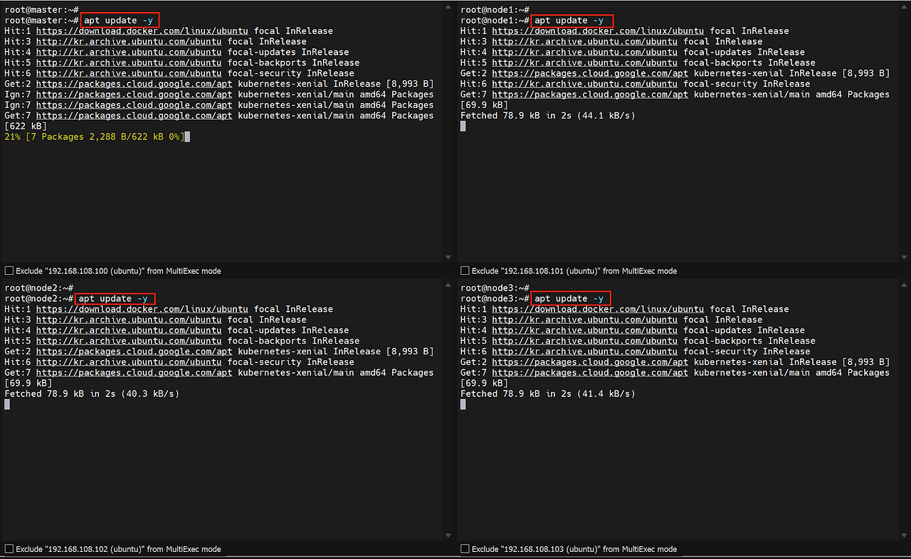
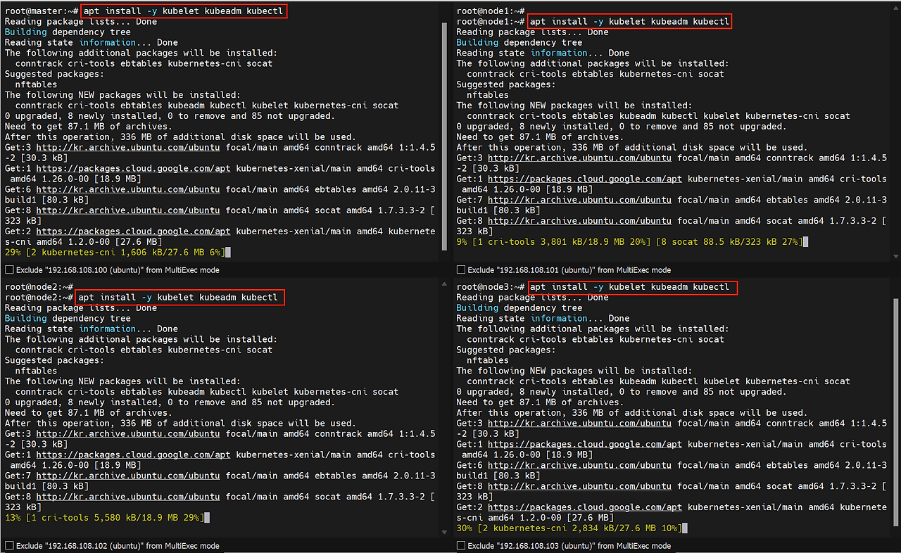
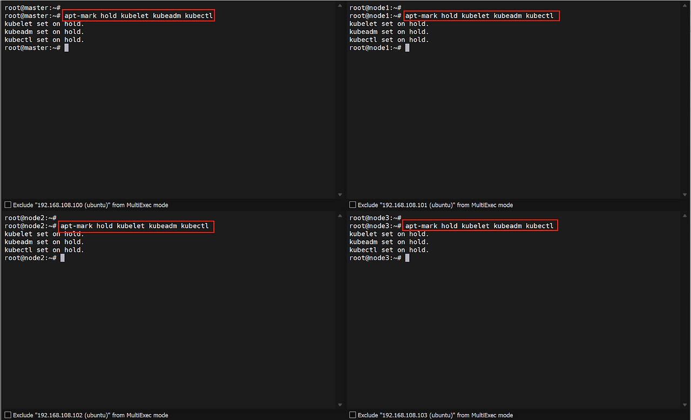
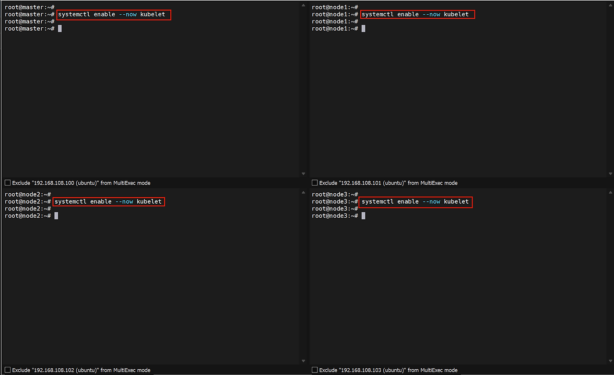
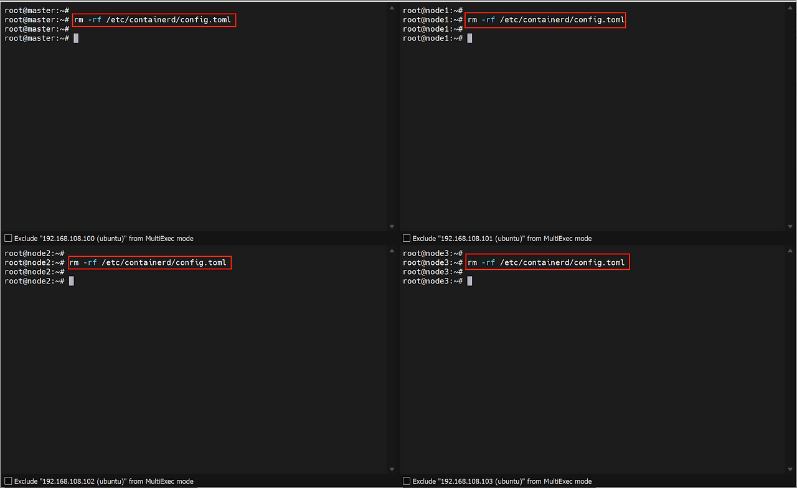
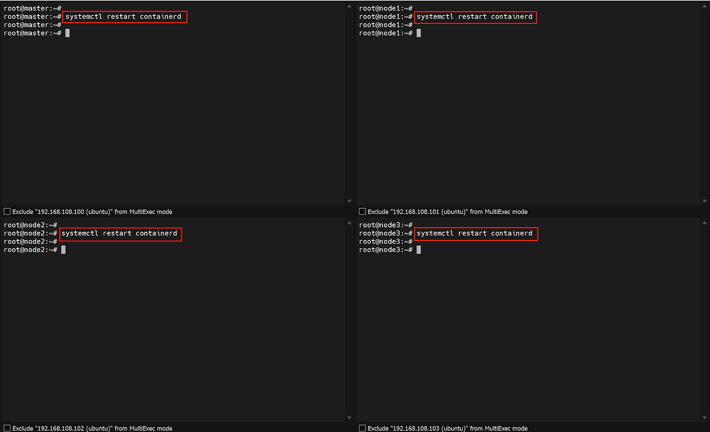

### 19. 쿠버네티스 설치

1. kubelet, kubeadm, kubectl 패키지 설치



    ```shell
    cat <<EOF | sudo tee /etc/apt/sources.list.d/kubernetes.list
    \>  deb https://apt.kubernetes.io/ kubernetes-xenial main
    \> EOF
     deb https://apt.kubernetes.io/
    ```




2. 자동으로 업데이트 되지 않도록 패키지의 현재 버전을 고정


3. kubelet 활성화


4. containerd 데몬 재실행



---

쿠버네티스는 공부할 준비도 빡세다....
