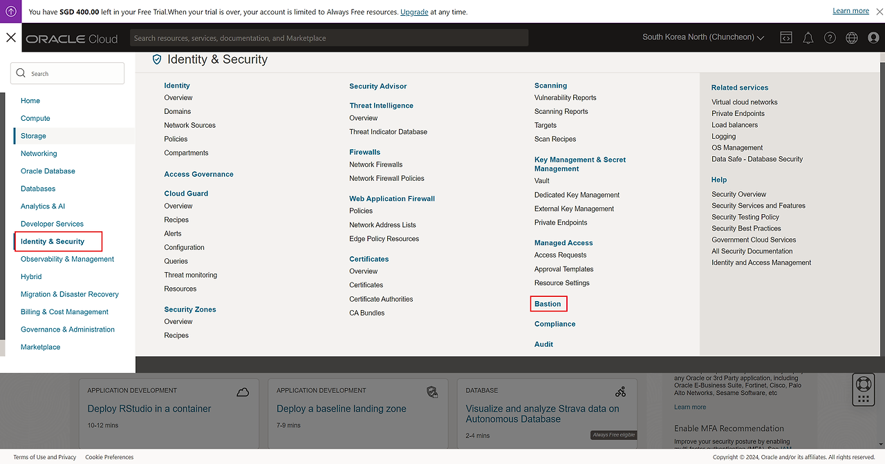
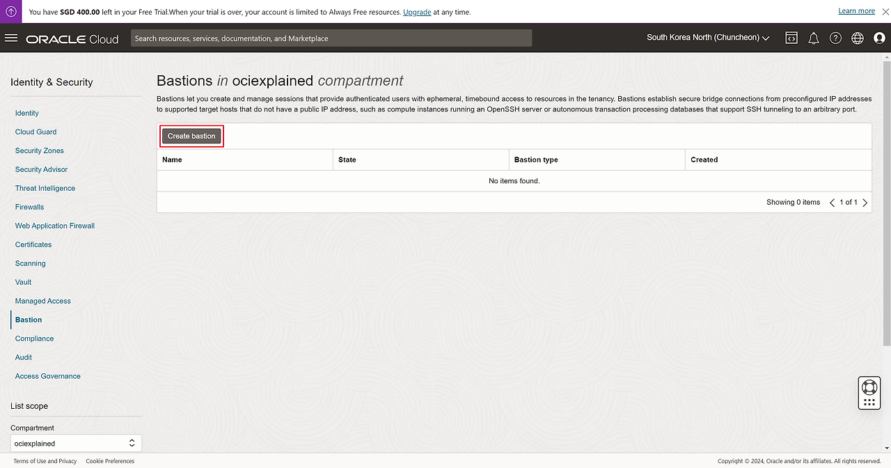
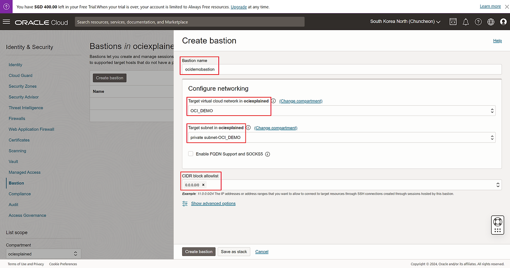
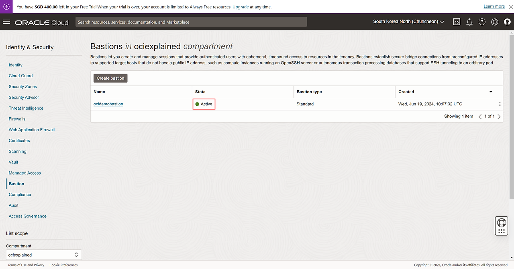

## 1. OCI에서의 Bastion 서버

오라클 클라우드는 VCN 내에서 퍼블릭 서브넷과 프라이빗 서브넷으로 안전한 네트워크 관리 체계를 구축할 수 있다.

퍼블릭 서브넷은 인터넷과 연결된 서비스를 배치하는 데 사용되고, 프라이빗 서브넷은 데이터베이스나 백엔드 서비스와 같은 내부 서비스를 배치하는 데 사용된다.

일반적으로 프라이빗 서브넷에 접근할 때 Bastion 서버나 점프 호스트를 사용한다. Bastion 서버는 외부 인터넷과 내부 네트워크 사이에 위치하며 내부 IT 자원에 안전하게 접근할 수 있도록 한다.

-   외부 인터넷에서 내부 서버에 접속하기 위한 출입구 역할
-   외부 네트워크와 내부 네트워크 사이에 위치해서 두 네트워크를 분리하는 역할로 사용
-   내부 서버에 접근하는 사용자들의 인증 및 권한을 관리해서 보안을 강화하는 데 사용

**오라클 클라우드에서는 이 Bastion을 별도 인스턴스 서버로 구성하지 않아도 무료 서비스로 제공하여 편하게 이용할 수 있다.**

## 2. Bastion 서버 생성

1\. 가상 머신과 관련한 기본 용어 및 개념1) 이미지이미지는 운영체제와 함께 설치되는 소프트웨어를 정의하는 가상 하드 드라이브 템플릿이다.인스턴스의 초기 상태를 정의하며, 여러 인스턴스

haksuperman.tistory.com](https://haksuperman.tistory.com/67)

해당 게시물에 작업한 환경에서 이어서 진행할 것이다.

1. \[Identity & Security → Bastion\] 선택

2. Create bastion 선택

3. Bastion name : ocidemobastion
Target virtual cloud network in ociexplained : OCI\_DEMO
Target subnet in ociexplained : private subnet-OCI\_DEMO
CIDR block allowlist : 0.0.0.0/0

4. Bastion 서비스를 이용한다고 해도 서버를 만드는 것이기 때문에 즉시 생성되지는 않는다.

5. Active 상태로 올라오는 것 확인

**이 Bastion 서버를 통해 프라이빗 서브넷의 인스턴스 서버에 안전하게 접속할 수 있다.**
