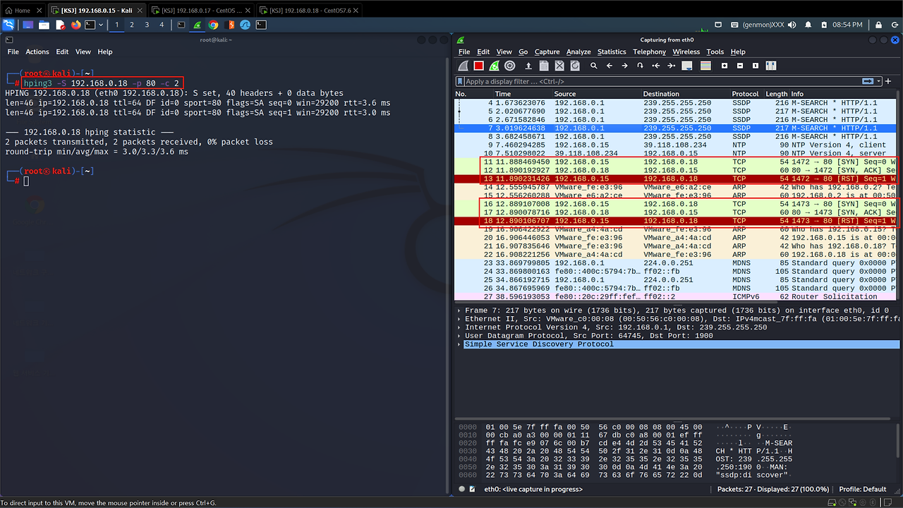
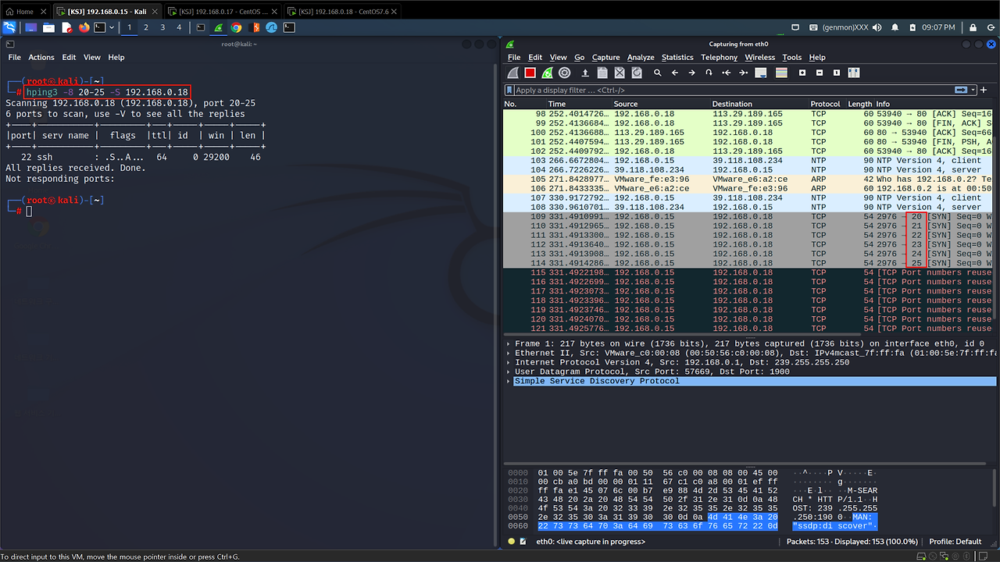
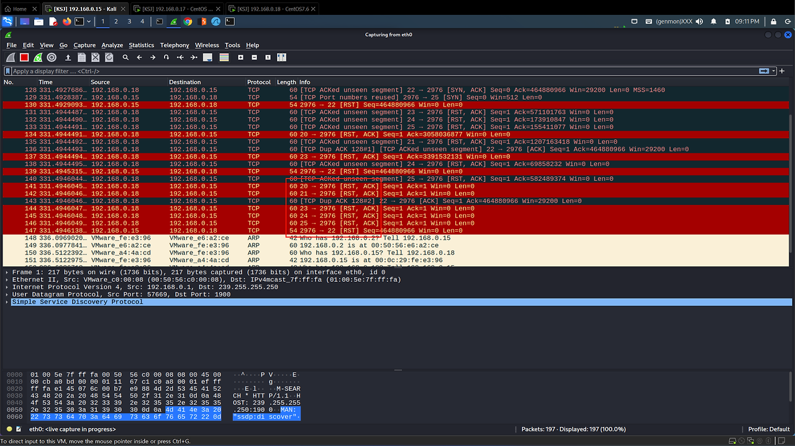
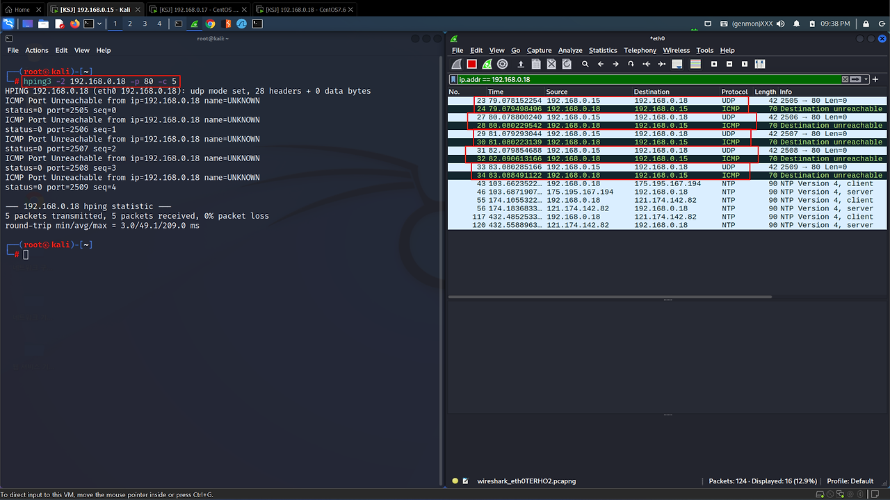
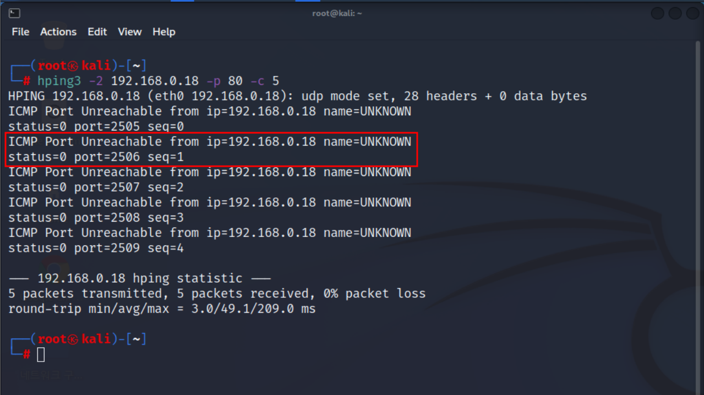
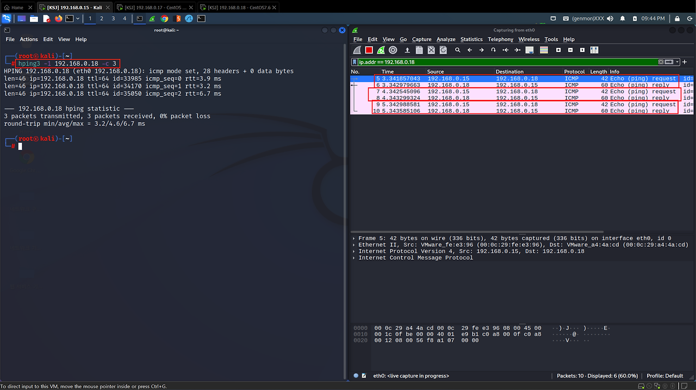
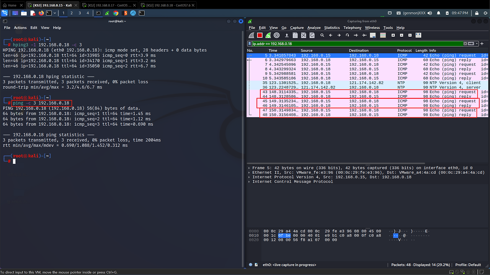

홈페이지의 경우 보안상의 이유로 ICMP 패킷을 차단하는 경우도 존재한다. 이러한 경우 서버가 구동이 되고 있는지 확인하기 위해서는 활성화 된 서비스가 있는 포트를 대상으로 서버가 존재하고 실행되고 있는지 스캔할 수 있다. 예를 들면 웹 서버에 HTTP 패킷을 보내 확인하는 방법이 있다.

## 1. SYN 스캔

#### 1) wireshark를 통한 스캔 결과 확인

Half Open 방식
(SYN -> SYN/ACK -> RST)
```bash
hping3 -S 192.168.0.18 -p 80 -c 2
```


#### 2) hping -8 옵션으로 각 포트번호를 늘려가며 스캔
1. 지정한 20-25번 포트를 하나씩 스캔
    ```bash
    hping3 -8 20-25 -S 192.168.0.18
    ```


2. 22번 포트만 활성화 되어 있기 때문에 22번으로만 RST 응답을 보냄, 나머지는 비활성화 되어 있기 때문에 RST/ACK을 받고 응답을 보내지 않음


## 2. UDP 스캔
1. UDP 패킷을 보내 ICMP 패킷으로 돌려받음
    ```bash
    hping3 -2 192.168.0.18 -p 80 -c 5
    ```


2. 80번 포트는 TCP 통신을 하는데, UDP 패킷으로 스캔해서 Unreachable이 뜨는 것


## 3. ICMP 스캔
1. ICMP는 3계층 프로토콜이라 IP 주소로 통신 -> 4계층인 Port 정보를 담지 못함(-p 옵션이 무의미)
```bash
hping3 -1 192.168.0.18 -c 3
```


2. 그냥 ping 명령도 ICMP를 사용하기 때문에 동일한 결과를 얻음

