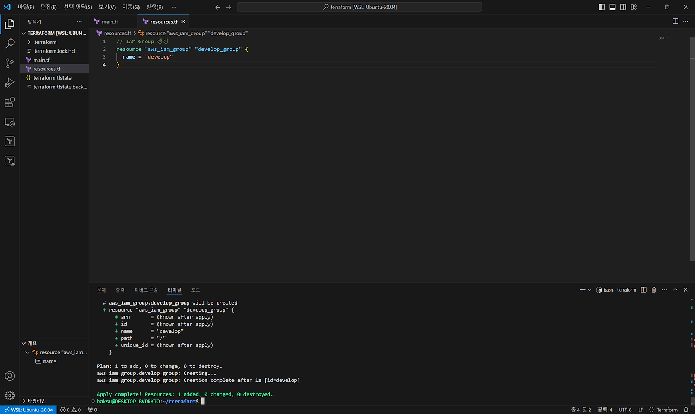
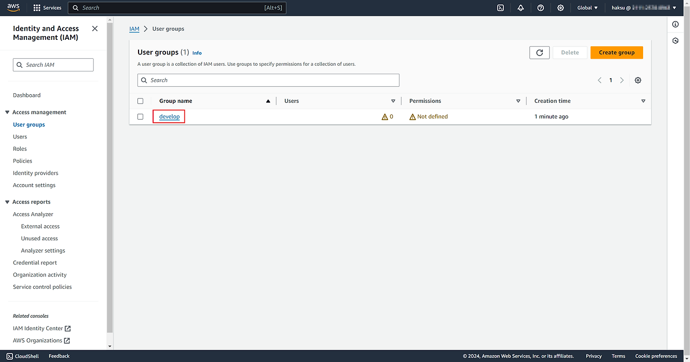
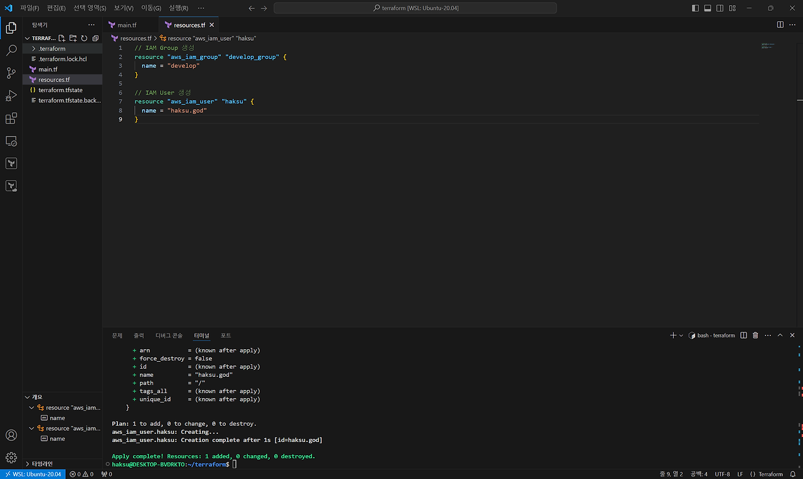
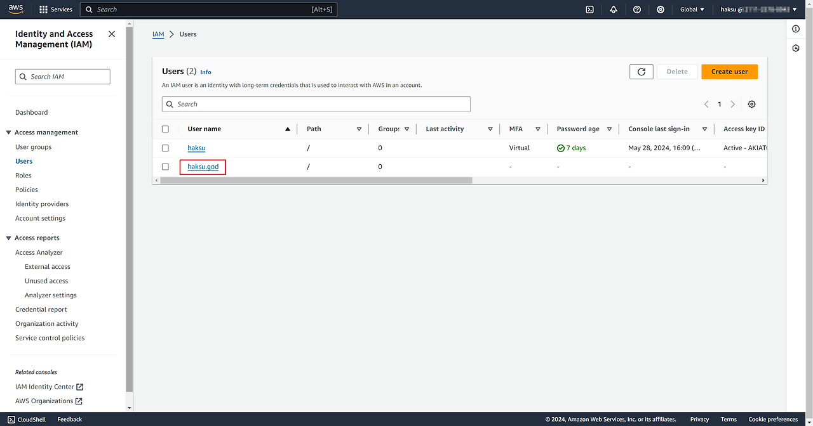
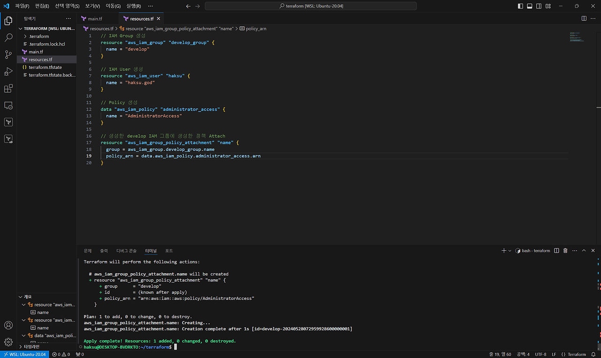
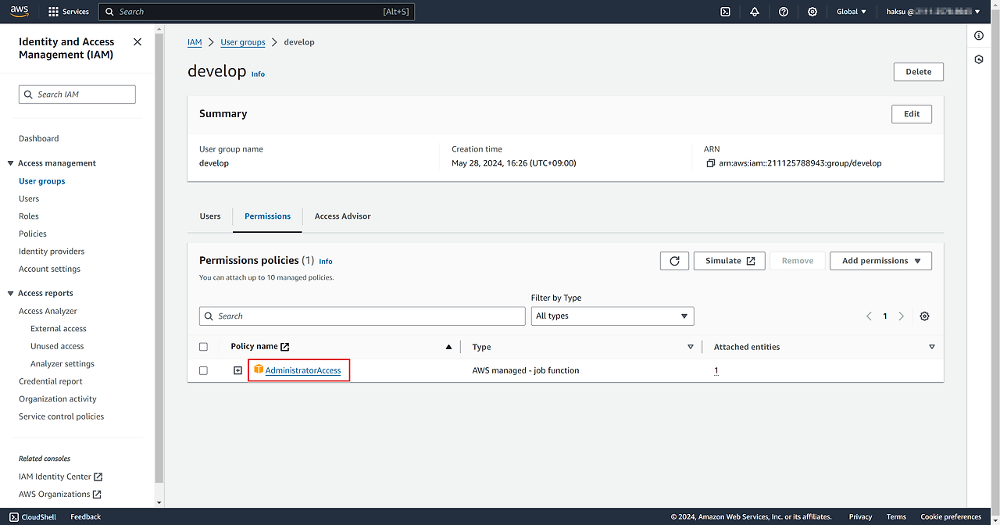
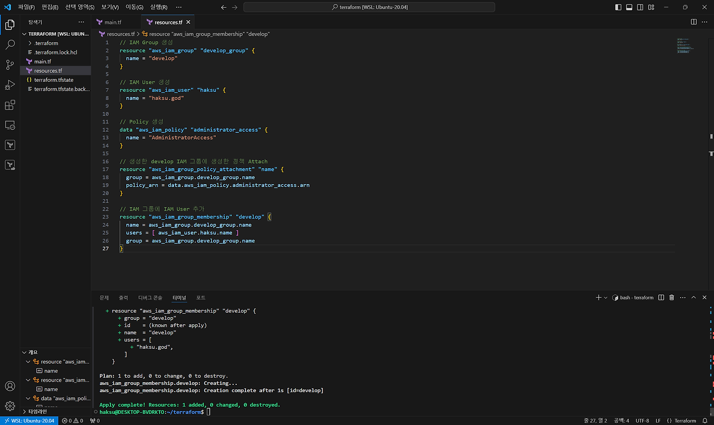
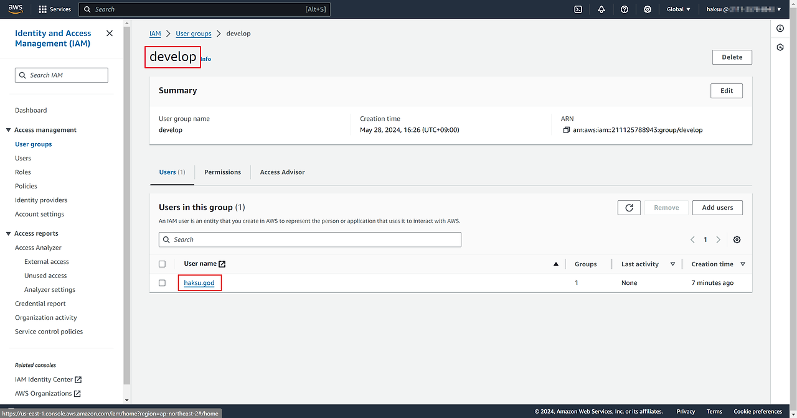

## 1. IAM Group 생성

```terraform
// IAM Group 생성
resource "aws_iam_group" "develop_group" {
  name = "develop"
}
```
1. develop 이라는 IAM Group 생성


2. 정상적으로 생성된 것 확인


## 2. IAM User 생성

```terraform
// IAM User 생성
resource "aws_iam_user" "haksu" {
  name = "haksu.god"
}
```

1. haksu.god 이라는 IAM User 생성


2. 정상적으로 생성된 것 확인


## 3. Policy 생성 및 생성한 develop 그룹에 Attach

```terraform
// Policy 생성
data "aws_iam_policy" "administrator_access" {
  name = "AdministratorAccess"
}

// 생성한 develop IAM 그룹에 생성한 정책 Attach
resource "aws_iam_group_policy_attachment" "name" {
  group = aws_iam_group.develop_group.name
  policy_arn = data.aws_iam_policy.administrator_access.arn
}
```

1. AdministratorAccess 권한을 가진 정책 생성 및 develop 그룹에 Attach
\-> AdministratorAccess 권한은 root 계정의 권한과 동일하다고 볼 수 있으니 꼭 필요 최소 권한만 부여하기(실습용으로만 부여)



## 4. develop 그룹에 haksu.got 계정 추가

```terraform
// IAM 그룹에 IAM User 추가
resource "aws_iam_group_membership" "develop" {
  name = aws_iam_group.develop_group.name
  users = [ aws_iam_user.haksu.name ]
  group = aws_iam_group.develop_group.name
}
```

1. 파이썬의 리스트 문법과 같은 개념으로 여러 IAM User 추가 가능


