> **목표:** 
> Oracle Linux 9 Compute VM에서 OCI Autonomous Database(Lakehouse)에 Wallet 기반 mTLS로 접속하고 SQL 실행을 검증한다.


---

## 1. 구성 개요

```
Oracle Linux 9 Compute VM
  └─ Oracle Instant Client / SQL*Plus
       └─ Private network / TCP 1522 / mTLS
            └─ OCI Autonomous Database (Lakehouse)
```

이 문서는 Private Endpoint와 Wallet 기반 mTLS를 기준으로 한다. Public Endpoint 또는 TLS-only 환경에서는 ADB의 실제 Network 및 Database connection 설정을 우선한다.

| 구분 | 플레이스홀더 |
| --- | --- |
| OCI 리전/Compartment | `<REGION> / <COMPARTMENT_NAME>` |
| VM 이름/IP/NSG | `<OL9_VM_NAME> / <OL9_VM_PRIVATE_IP> / <OL9_VM_NSG>` |
| ADB 표시 이름 | `<ADB_DISPLAY_NAME>` |
| Database Name | `<ADB_DATABASE_NAME>` |
| Workload Type | `Lakehouse` |
| Access Type | `Private Endpoint / Public Endpoint` |
| ADB 호스트/포트 | `<ADB_HOST> / 1522` |
| ADB NSG | `<ADB_NSG>` |
| 접속 사용자 | `<ADB_USER>` |
| TNS Alias | `<TNS_ALIAS>` |
| Wallet 경로 | `/home/opc/adb_wallet/<ADB_NAME>` |

## 2. 사전 준비 및 주의사항

- ADB가 `AVAILABLE` 상태여야 한다.
- OL9 VM에 SSH 접속할 수 있어야 한다.
- Private Endpoint 사용 시 VM과 ADB 사이의 사설 경로가 준비되어야 한다.
- Database connection에서 **Mutual TLS authentication required** 여부를 확인한다.
- DB 사용자 암호와 Wallet 암호를 구분한다.
- Wallet 파일과 암호를 문서·Git·공용 저장소에 노출하지 않는다.
- `high`, `medium`, `low` 등의 TNS Alias 중 관리자가 지정한 서비스를 사용한다.

## 3. Access Type별 네트워크 및 보안 규칙

ADB의 Access Type은 엔드포인트 종류와 OL9 VM의 접속 경로를 결정한다. 세 선택지 모두 인증서 기반 SSL/TLS를 사용하지만, Public/Private Endpoint와 접근 제어 방식이 다르다.


> [!NOTE] **이 문서의 선택:**
> 이 가이드에서는 ADB Private Endpoint를 DB 서비스의 접속 지점으로 구성하므로 **DB용 Private Subnet을 선택한다.** 선택한 DB용 Subnet의 CIDR에서 Private Endpoint IP가 할당되며, OL9 VM은 OL9용 Subnet에서 VCN Local Routing을 통해 해당 Endpoint에 접속한다.


### 3.1 Access Type 비교

| Access Type | ADB 엔드포인트 | 접근 제어 | OL9 VM의 대표 접속 경로 |
| --- | --- | --- | --- |
| **Secure access from everywhere** | Public IP/hostname | 모든 IP에서 접근 가능. 별도 ACL 없음 | Service Gateway, NAT Gateway 또는 Internet Gateway → Public Endpoint |
| **Secure access from allowed IPs and VCNs only** | Public IP/hostname | 지정한 공인 IP/CIDR 또는 Service Gateway를 사용하는 VCN만 ACL로 허용 | 허용 VCN은 Service Gateway, 허용 공인 IP는 NAT/Internet Gateway → Public Endpoint |
| **Private endpoint access only** | 선택한 VCN/Subnet의 Private IP/hostname | 지정 VCN·Peered VCN·연결된 On-premises 경로와 NSG/Security List로 제어 | VCN Local Routing, LPG/DRG/Peering → Private Endpoint |


> [!NOTE]
> ADB는 선택한 **Access Type에 따라 생성되는 엔드포인트, 허용되는 접속 출발지, OL9 VM에서 ADB까지의 접근 경로가 달라진다.** 
> 따라서 먼저 현재 Access Type을 확인한 후 해당 방식에 맞는 접속 경로를 구성해야 한다. 
> 아래 3.2~3.4에서는 각 Access Type별 접근 방식과 확인 항목을 구분하여 설명한다.


### 3.2 Secure access from everywhere

ADB에 Public Endpoint가 생성되고 모든 출발 IP가 허용된다. ADB ACL 조건은 없지만 OL9 VM에서 Public Endpoint까지의 네트워크 경로는 필요하다.

| OL9 VM 위치 | 필요한 경로 | ADB ACL |
| --- | --- | --- |
| Private Subnet | Service Gateway 또는 NAT Gateway | 없음 |
| Public Subnet + VM Public IP | Internet Gateway | 없음 |

#### 필요한 네트워크 보안 설정

Public Endpoint가 사용자 VCN 안에 생성되는 방식이 아니므로 ADB Endpoint용 Ingress NSG/Security List는 작성하지 않는다.

| 적용 위치 | 방향 | 허용 대상 | 포트 |
| --- | --- | --- | --- |
| OL9 NSG 또는 Subnet Security List | Egress | 실제 경로의 Public Endpoint 또는 Oracle Services Network<br>(일반적으로 `0.0.0.0/0 -> All Protocols` Egress 허용) | TCP 1522 |
| ADB ACL | 해당 없음 | 별도 ACL 없음 | 해당 없음 |

Stateful Egress 규칙을 사용하는 경우 응답 트래픽을 위한 별도 Ingress 규칙은 일반적으로 필요하지 않다.

보안상 접근 출발지를 제한해야 하는 운영 환경에서는 **Secure access from allowed IPs and VCNs only** 또는 **Private endpoint access only**를 검토한다.

### 3.3 Secure access from allowed IPs and VCNs only

ADB에 Public Endpoint가 생성되며 ACL에 등록된 출발지만 허용된다.

| ACL 등록 방식 | OL9 VM의 필수 접속 경로 | ACL에 입력할 값 |
| --- | --- | --- |
| Virtual Cloud Network | Service Gateway → Oracle Services Network | OL9 VM이 속한 VCN OCID. 필요하면 Private IP/Subnet CIDR 추가 제한 |
| IP address/CIDR | Private Subnet → NAT Gateway | OCI NAT Gateway의 Public IP/CIDR |
| IP address/CIDR | Public Subnet → Internet Gateway | OL9 VM VNIC의 Public IP/CIDR |

VCN OCID 허용은 트래픽이 Service Gateway를 통해 전달될 때 사용한다.

```
Destination: All Seoul Region Services in Oracle Services Network
Target:      Service Gateway
```

Service Gateway가 없고 **0.0.0.0/0 → NAT Gateway**만 있다면 ADB에는 NAT Gateway의 공인 IP가 출발지로 보인다. 
이 경우 같은 VCN의 VM이어도 VCN OCID가 아니라 NAT Gateway Public IP를 ACL에 허용해야 한다.

#### 필요한 네트워크 보안 설정

Public Endpoint 방식이므로 ADB Endpoint용 Ingress NSG/Security List는 작성하지 않는다. 
ADB ACL 값과 OL9의 실제 Egress 경로가 서로 일치해야 한다.

| 실제 경로 | ADB ACL에 허용할 값 | OL9 NSG/Security List Egress |
| --- | --- | --- |
| Service Gateway | OL9가 속한 VCN OCID | `All Seoul Region Services in Oracle Services Network` 방향 TCP 1522<br>(일반적으로 `0.0.0.0/0 -> All Protocols` Egress 허용) |
| NAT Gateway | NAT Gateway Public IP/CIDR | ADB Public Endpoint 방향 TCP 1522<br>(일반적으로 `0.0.0.0/0 -> All Protocols` Egress 허용) |
| Internet Gateway | OL9 VNIC Public IP/CIDR | ADB Public Endpoint 방향 TCP 1522<br>(일반적으로 `0.0.0.0/0 -> All Protocols` Egress 허용) |

Stateful Egress 규칙을 사용하는 경우 응답 트래픽을 위한 별도 Ingress 규칙은 일반적으로 필요하지 않다.

### 3.4 Private endpoint access only

ADB에 선택한 VCN/Subnet의 Private Endpoint가 생성된다. 여기서 선택하는 Subnet은 접속을 허용할 클라이언트 Subnet이 아니라, **ADB Private Endpoint의 VNIC와 Private IP가 생성될 위치**다. 
ADB Serverless 본체는 Oracle 관리 영역에 있으므로 사용자의 VCN 안에 별도로 선택할 “ADB 본체 Subnet”이 존재하는 것은 아니다.

Public Endpoint를 사용하지 않으므로 동일 VCN 내 다른 Subnet에서는 NAT, Internet, Service Gateway 없이 VCN Local Routing으로 접속한다.

```
OL9 VM Private IP
→ VCN Local Routing
→ ADB Private Endpoint IP
→ Oracle 관리 영역의 ADB
```

Subnet을 선택하는 행위 자체가 해당 Subnet에서의 접근을 허용하는 것은 아니다. 
실제 접근 범위는 ADB Private Endpoint에 연결한 NSG와 Subnet Security List로 제어한다. 

Private Endpoint 생성 및 접속 전에 다음 항목을 구분하여 확인한다.

| 구분 | 확인 항목 | 필요성 |
| --- | --- | --- |
| 생성 필수 | 선택한 DB용 Subnet에 Endpoint에 할당할 사용 가능한 Private IP가 있는지 확인 | Private IP를 할당할 수 없으면 Endpoint를 생성할 수 없음 |
| 생성 필수 | 선택한 Subnet이 VCN 기본 DHCP 옵션을 사용하고 DNS 이름 해석이 가능한지 확인 | Oracle의 Private Endpoint Subnet 사전 요구사항이며 Wallet hostname 해석에 필요 |
| 접속 필수 | OL9 측 Egress와 ADB Endpoint 측 Ingress를 포함한 적용 보안 규칙에서 TCP 1522가 허용되는지 확인 | 허용 규칙이 없으면 VCN Local Routing이 있어도 접속할 수 없음 |
| 보안 권장 | ADB Endpoint Ingress Source를 OL9 NSG 또는 필요한 Private IP/CIDR로 최소화 | 접속에 필요한 출발지만 허용하기 위한 최소 권한 설정 |

#### 필요한 네트워크 보안 설정

Private Endpoint는 선택한 DB용 Subnet의 VNIC에 연결되므로 Endpoint 측 Ingress와 OL9 측 Egress를 확인한다.

| 적용 위치 | 방향 | Source 또는 Destination | 포트 |
| --- | --- | --- | --- |
| ADB Private Endpoint NSG | Ingress | `<OL9_VM_NSG>`, `<OL9_VM_PRIVATE_IP>/32` 또는 OL9 Subnet CIDR | TCP 1522 |
| OL9 NSG 또는 Subnet Security List | Egress | ADB Endpoint NSG, Private IP 또는 DB Subnet CIDR | TCP 1522 |


> [!WARNING]
> Stateful 규칙을 권장한다. TLS-only 구성은 실제 접속 문자열에 따라 1521 또는 1522를 사용하므로 Wallet의 `tnsnames.ora`에 기재된 포트를 기준으로 설정한다.


### 3.5 현재 Access Type과 접속 경로 확인

1. ADB 상세 화면의 **Network → Access type**을 확인한다.
2. Public Endpoint이면 OL9 Subnet Route Table의 Service/NAT/Internet Gateway 경로를 확인한다.
3. Allowed IPs/VCNs 방식이면 실제 경로와 ACL 등록 값이 일치하는지 확인한다.
4. Private Endpoint이면 Private IP/hostname, VCN, Subnet, NSG를 확인한다.
5. Wallet의 **tnsnames.ora HOST**가 현재 엔드포인트 유형과 일치하는지 확인한다.

[Oracle 공식 문서 — About Network Access Options](https://docs.oracle.com/en-us/iaas/autonomous-database-serverless/doc/network-access-options.html)
[Oracle 공식 문서 — Configure ACLs](https://docs.oracle.com/en-us/iaas/autonomous-database-serverless/doc/access-control-rules-autonomous.html)
[Oracle 공식 문서 — Configure Private Endpoints](https://docs.oracle.com/en-us/iaas/autonomous-database-serverless/doc/private-endpoints-autonomous.html)


> [!WARNING]
> Wallet에 포함되는 접속 정보는 ADB의 Endpoint 구성에 따라 달라진다. 
> 따라서 Access Type을 변경하여 Public Endpoint와 Private Endpoint 사이를 전환했다면, 변경 완료 후 **접속에 사용할 Wallet을 다시 다운로드하여 OL9 VM에 배포해야 한다.**
> 
> 새 Wallet의 `tnsnames.ora`에 현재 Access Type에 맞는 Endpoint hostname과 포트가 포함되어 있는지 확인하고, 이전 Endpoint 정보가 포함된 기존 Wallet은 계속 사용하지 않는다.


## 4. Wallet과 접속 정보 준비

### 4.1 OCI 콘솔에서 Wallet 다운로드

1. **Oracle Database → Autonomous Database**
2. `<ADB_DISPLAY_NAME>` 선택
3. 우측 상단 **Database connection → Download wallet**
4. Instance Wallet 다운로드 및 Wallet ZIP 암호 설정
    
    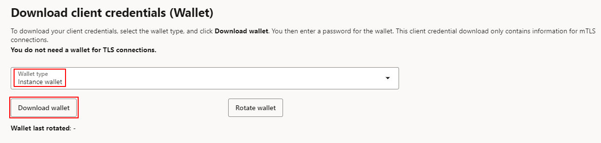
    
    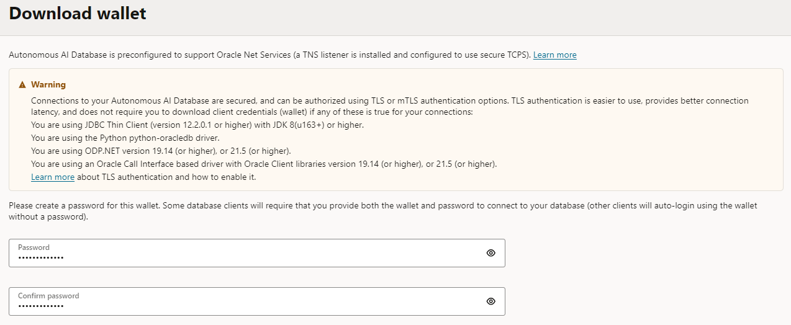
    

### 4.2 Wallet 파일 전송 및 디렉터리 배치

다운로드한 Wallet ZIP 파일을 **안전한 방법으로 Oracle Linux 9 Compute VM의 `/home/opc/` 경로에 전송한 뒤**, 다음과 같이 Wallet 디렉터리를 생성하고 압축을 해제한다. 
아래 명령은 Compute VM의 `opc` 계정에서 실행한다.

```bash
mkdir -p /home/opc/adb_wallet/<ADB_NAME>
chmod 700 /home/opc/adb_wallet /home/opc/adb_wallet/<ADB_NAME>

unzip /home/opc/Wallet_<ADB_NAME>.zip \
  -d /home/opc/adb_wallet/<ADB_NAME>

chmod 600 /home/opc/adb_wallet/<ADB_NAME>/*
ls -la /home/opc/adb_wallet/<ADB_NAME>
```

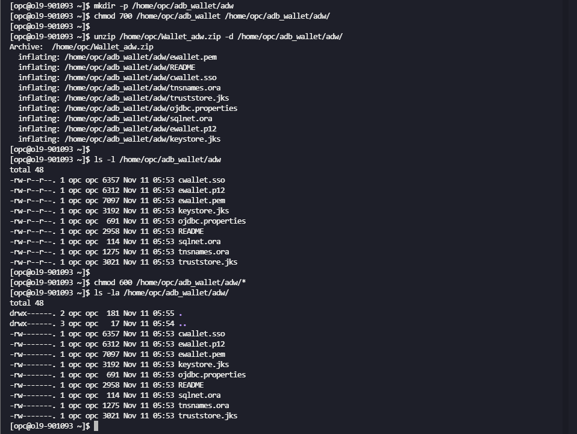

압축 해제 후 주요 파일은 다음 경로에 배치된다.

```
/home/opc/adb_wallet/<ADB_NAME>/
├── tnsnames.ora
├── sqlnet.ora
├── cwallet.sso
└── ewallet.p12
```

Wallet 유형에 따라 다른 파일도 포함될 수 있다. Wallet ZIP 및 암호는 외부에 노출하지 않는다.

### 4.3 sqlnet.ora Wallet 위치 확인

`sqlnet.ora`의 `WALLET_LOCATION` 설정이 실제 압축 해제 경로를 가리키는지 확인한다.

```bash
vi /home/opc/adb_wallet/<ADB_NAME>/sqlnet.ora
```

Wallet 경로 수정 예시(기존 기타 설정은 유지):

```
WALLET_LOCATION = (SOURCE = (METHOD = file)
  (METHOD_DATA =
    (DIRECTORY="/home/opc/adb_wallet/<ADB_NAME>")
  )
)
SSL_SERVER_DN_MATCH=yes
```

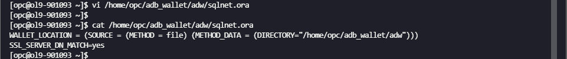


> [!INFO]
> 사용하는 Oracle Client 버전과 Wallet 유형에 따라 경로 설정 방식이 다를 수 있으므로 다운로드된 `sqlnet.ora`의 기존 내용을 먼저 확인한다.


### 4.4 TNS_ADMIN 환경변수 설정

```bash
export TNS_ADMIN=/home/opc/adb_wallet/<ADB_NAME>
echo "$TNS_ADMIN"
```

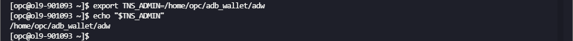

SSH 재접속 후에도 동일한 경로를 사용하려는 경우:

```bash
echo 'export TNS_ADMIN=/home/opc/adb_wallet/<ADB_NAME>' >> ~/.bashrc
```

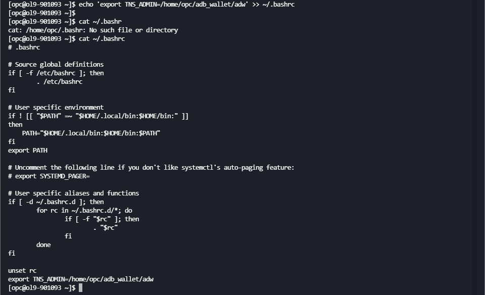


> [!INFO]
> `~/.bashrc` 설정은 opc 사용자의 Bash 셸에 적용된다. 
> 별도의 systemd 서비스나 다른 계정으로 실행하는 프로그램은 해당 실행 환경에 별도로 설정해야 한다.


### 4.5 ADB 접속 서비스명 확인

```bash
grep -E '^[[:alnum:]_.-]+[[:space:]]*=' "$TNS_ADMIN/tnsnames.ora"
```

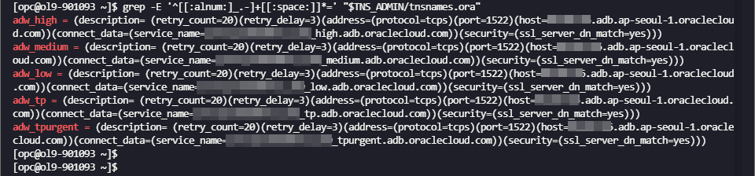

출력된 실제 서비스명(예: `<ADB_NAME>_low`)을 이후 7번 SQL*Plus 접속 단계의 `<TNS_ALIAS>`에 사용한다.

Wallet 파일 압축 해제와 경로 설정이 완료되고 접속까지 검증되면, 서버에 임시 전송한 ZIP은 필요에 따라 삭제할 수 있다.

```bash
rm -i /home/opc/Wallet_<ADB_NAME>.zip
```

원본 Wallet ZIP은 별도의 안전한 위치에 보관한다.

## 5. Oracle Linux 9에 SQL*Plus 설치

```bash
cat /etc/oracle-release
uname -m
sudo dnf repolist

sudo dnf install -y oracle-instantclient-release-23ai-el9
sudo dnf install -y oracle-instantclient-basic
sudo dnf install -y oracle-instantclient-sqlplus

command -v sqlplus
sqlplus -v
```

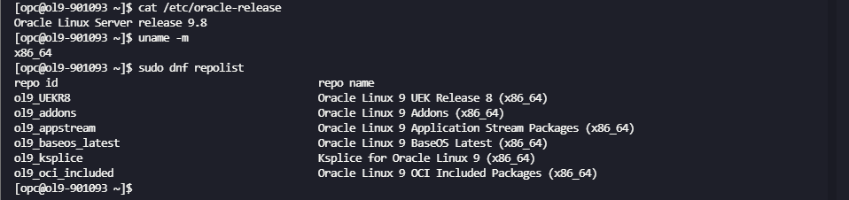

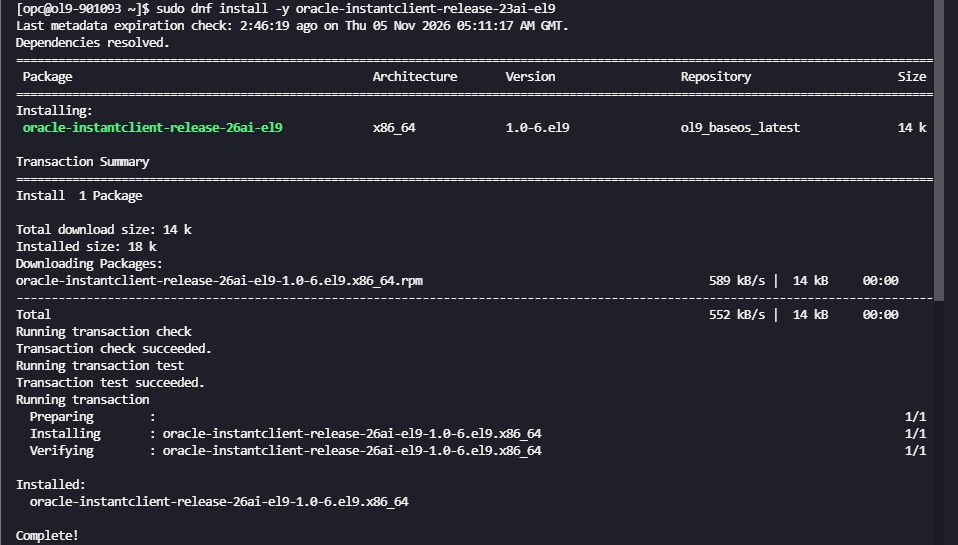

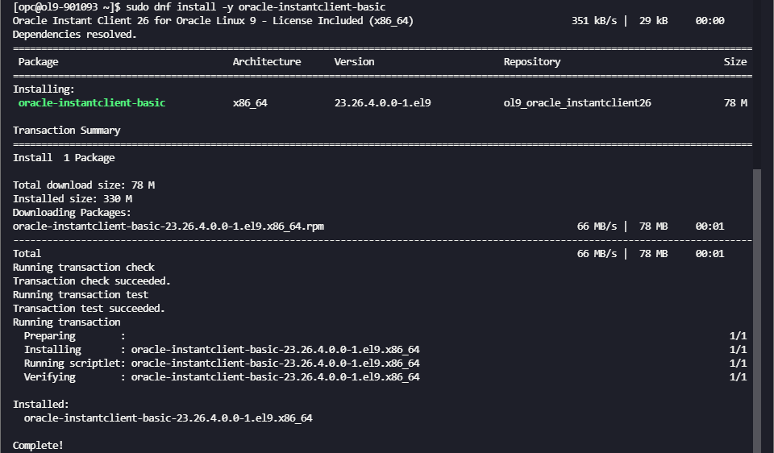

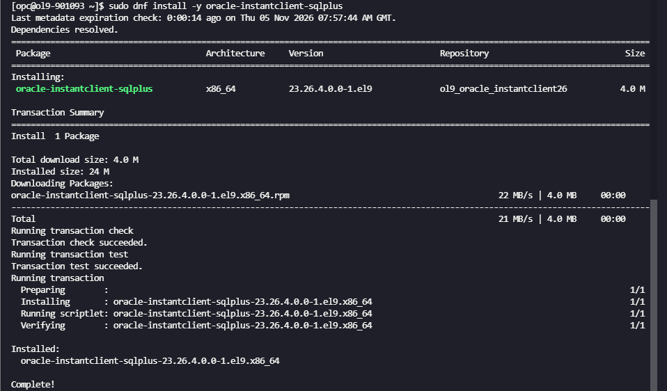

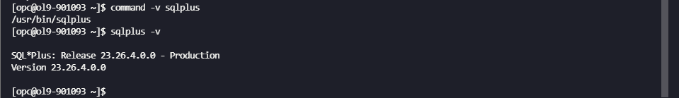

조직에서 승인한 저장소나 특정 Instant Client 버전이 있으면 그 표준을 따른다. DB 서버 소프트웨어는 VM에 설치하지 않는다.

## 6. DNS와 TCP 1522 사전 점검

### 6.1 호스트와 포트 확인

```bash
grep -Ei 'host|port|service_name'   "$TNS_ADMIN/tnsnames.ora"
```

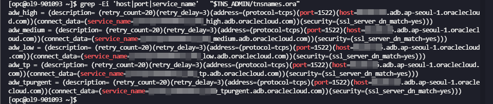


> [!INFO]
> **ADB 접속 서비스별 차이**
> 
> | 서비스 | 실행 특성 | 동시성 | 주요 용도 |
> | --- | --- | --- | --- |
> | `high` | 높은 우선순위, 병렬 실행 | 낮음. 한도를 넘으면 대기 가능 | 소수 사용자의 대규모 분석, 고우선순위 리포트·배치 |
> | `medium` | 일반 우선순위, 병렬 실행 | 중간 | 대용량 조회, 일반 분석, 리포트·배치 |
> | `low` | 낮은 우선순위, 병렬 실행 없음 | 높음 | 짧은 SQL, 접속 점검, 일반 도구, 반복 모니터링 |
> 
> 여기서는 `<ADB_NAME>_low`를 사용한다. (OL9 접속 및 SQL 실행 검증)
> 
> - 모니터링과 같이 짧고 반복적인 모니터링 쿼리를 실행한다면 `low`를 우선 검토한다.
> - 무거운 분석 쿼리가 필요한 경우에만 `medium` 또는 `high`를 별도로 검토한다.
> 
> [Oracle 공식 문서 — Database Service Names for Autonomous AI Database](https://docs.oracle.com/en-us/iaas/autonomous-database-serverless/doc/predefined-database-services-names.html)


### 6.2 DNS 확인

```bash
getent ahostsv4 <ADB_HOST>
```

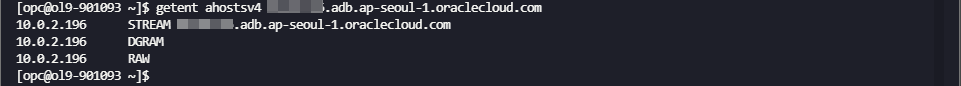

### 6.3 TCP 확인

```bash
timeout 5 bash -c 'cat < /dev/null > /dev/tcp/<ADB_HOST>/1522'   && echo "TCP 1522 reachable"   || echo "TCP 1522 failed"
```

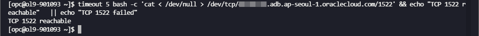

`nc`가 설치되어 있다면:

```bash
nc -vz -w 5 <ADB_HOST> 1522
```

## 7. SQL*Plus로 mTLS 접속

### 7.1 접속 전 최종 확인

3번에서 구분한 Access Type에 따라 다음을 확인한다.

| Access Type | 접속 전 확인 사항 |
| --- | --- |
| Secure access from everywhere | Public Endpoint까지의 Service/NAT/Internet Gateway 경로 |
| Secure access from allowed IPs and VCNs only | 실제 Gateway 경로와 ACL의 VCN OCID 또는 공인 출발 IP가 일치 |
| Private endpoint access only | Wallet HOST가 Private Endpoint hostname인지, VCN 사설 경로와 NSG TCP 1522 허용 여부 |

6번에서 동일한 Wallet을 사용하여 Endpoint hostname, 포트, DNS 및 TCP 연결을 확인했다. 
이후 Access Type, Wallet 또는 네트워크 설정을 변경하지 않았다면 동일한 명령을 반복하지 않고 SQL*Plus 접속을 진행한다.

새 SSH 세션을 시작한 경우에는 `TNS_ADMIN`이 올바르게 설정되었는지만 확인한다.

```bash
echo "$TNS_ADMIN"
```

Access Type이나 Wallet을 변경했거나 DNS·네트워크 문제를 진단하는 경우에만 6번의 hostname, 포트, DNS 및 TCP 점검을 다시 수행한다.


> [!WARNING]
> **ORA-12506:** ADB 리스너까지 도달했지만 실제 출발지가 Service ACL과 일치하지 않는 상태다. **Secure access from allowed IPs and VCNs only**에서 주로 확인하며, Wallet이나 DB 암호보다 Access Type·Route Table·ACL 값을 먼저 점검한다.
> 
> [Oracle 공식 문서 — ORA-12506](https://docs.oracle.com/en/error-help/db/ora-12506/)


### 7.2 SQL*Plus 접속

```bash
export TNS_ADMIN=/home/opc/adb_wallet/<ADB_NAME>
sqlplus <ADB_USER>@<TNS_ALIAS>
```

예:

```bash
sqlplus admin@<adb_name>_low
```

암호 프롬프트에는 DB 사용자 암호를 입력한다. 

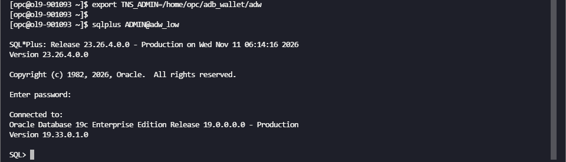

접속 후:

```sql
SHOW USER

SELECT SYS_CONTEXT('USERENV', 'DB_NAME') AS DB_NAME FROM DUAL;
SELECT SYS_CONTEXT('USERENV', 'SERVICE_NAME') AS SERVICE_NAME FROM DUAL;
SELECT SYS_CONTEXT('USERENV', 'NETWORK_PROTOCOL') AS NETWORK_PROTOCOL FROM DUAL;
```

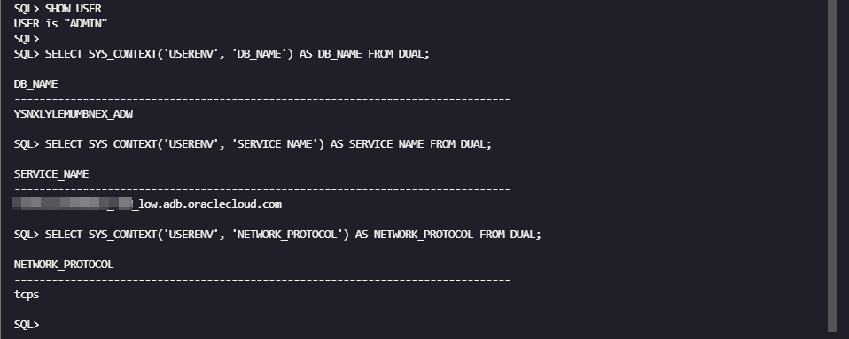

mTLS 연결에서는 일반적으로 `NETWORK_PROTOCOL = tcps`로 표시된다.

## 8. SQL 실행 및 검증

### 8.1 기본 정보

```sql
SELECT USER AS LOGIN_USER FROM DUAL;
SELECT CURRENT_TIMESTAMP AS DB_TIME FROM DUAL;
SELECT BANNER_FULL FROM V$VERSION;
SELECT 1 AS CONNECTION_TEST FROM DUAL;
```

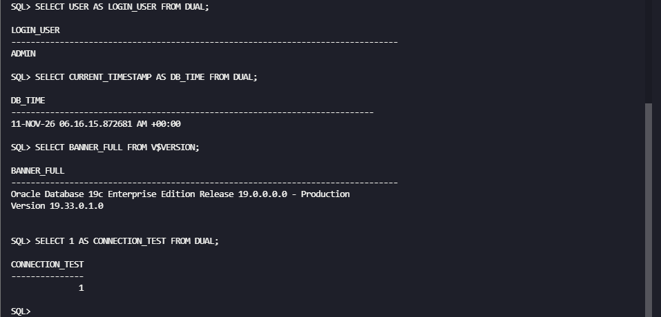

### 8.2 보안 연결

```sql
SELECT
    SYS_CONTEXT('USERENV', 'NETWORK_PROTOCOL') AS NETWORK_PROTOCOL,
    SYS_CONTEXT('USERENV', 'SERVICE_NAME') AS SERVICE_NAME,
    SYS_CONTEXT('USERENV', 'IP_ADDRESS') AS CLIENT_IP
FROM DUAL;
```

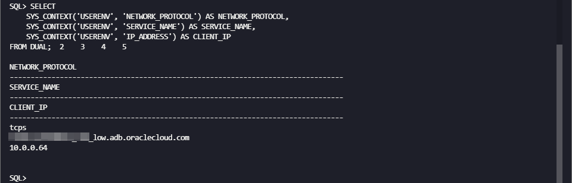

판정 기준은 `NETWORK_PROTOCOL = tcps`인지, `SERVICE_NAME`이 선택한 TNS 서비스와 일치하는지 확인하는 것이다. 
`CLIENT_IP`는 Access Type과 실제 Gateway 경로에 따라 다르게 표시될 수 있으므로 고정된 성공 판정값으로 사용하지 않고, 실제 접속 경로를 확인하기 위한 참고·진단 값으로 기록한다.

### 8.3 쓰기와 정리

승인된 테스트 사용자에서만 실행한다.

```sql
CREATE TABLE OL9_CONNECTION_TEST (
    ID NUMBER,
    MESSAGE VARCHAR2(100),
    CREATED_AT TIMESTAMP WITH TIME ZONE DEFAULT SYSTIMESTAMP
);

INSERT INTO OL9_CONNECTION_TEST (ID, MESSAGE)
VALUES (1, 'ADB connection test');

SELECT * FROM OL9_CONNECTION_TEST;

ROLLBACK;

SELECT COUNT(*) AS ROW_COUNT_AFTER_ROLLBACK
FROM OL9_CONNECTION_TEST;

DROP TABLE OL9_CONNECTION_TEST PURGE;
```

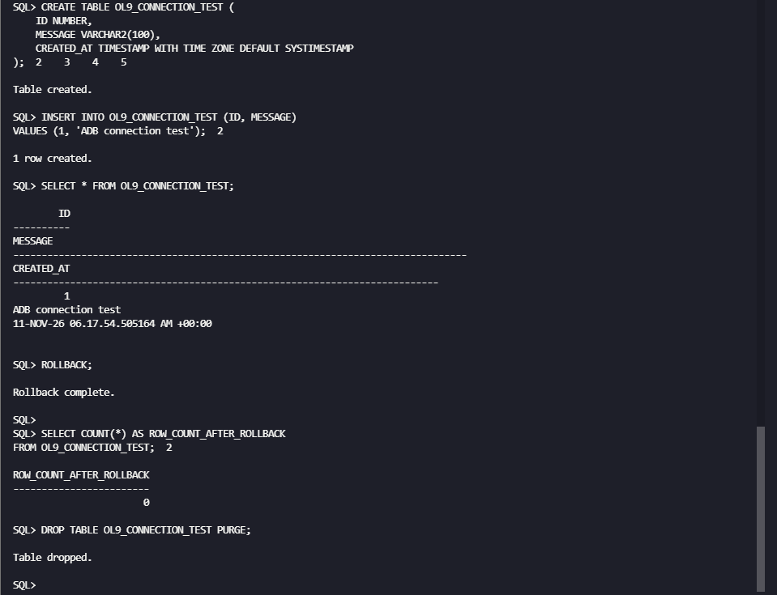


> [!INFO]
> Oracle DDL은 암시적 COMMIT을 발생시킨다. 
> `ROLLBACK`은 INSERT 행을 취소하지만 CREATE TABLE은 취소하지 않으므로 `DROP TABLE ... PURGE`가 필요하다.


테이블 생성 권한이 없는 계정은 읽기 SQL까지만 검증한다.

## 9. SQL 파일로 일괄 검증

`/home/opc/adb_precheck.sql`:

```sql
WHENEVER OSERROR EXIT FAILURE
WHENEVER SQLERROR EXIT SQL.SQLCODE

SET ECHO ON
SET FEEDBACK ON
SET PAGESIZE 100
SET LINESIZE 200

SHOW USER
SELECT SYS_CONTEXT('USERENV', 'DB_NAME') AS DB_NAME FROM DUAL;
SELECT SYS_CONTEXT('USERENV', 'SERVICE_NAME') AS SERVICE_NAME FROM DUAL;
SELECT SYS_CONTEXT('USERENV', 'NETWORK_PROTOCOL') AS NETWORK_PROTOCOL FROM DUAL;
SELECT USER AS LOGIN_USER FROM DUAL;
SELECT CURRENT_TIMESTAMP AS DB_TIME FROM DUAL;
SELECT 1 AS CONNECTION_TEST FROM DUAL;

EXIT SUCCESS
```

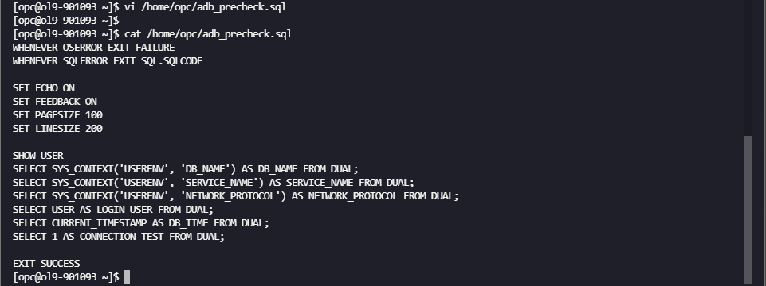

```bash
export TNS_ADMIN=/home/opc/adb_wallet/<ADB_NAME>

sqlplus -L <ADB_USER>@<TNS_ALIAS>   @/home/opc/adb_precheck.sql

sqlplus_rc=$?
echo "sqlplus exit code: $sqlplus_rc"
```

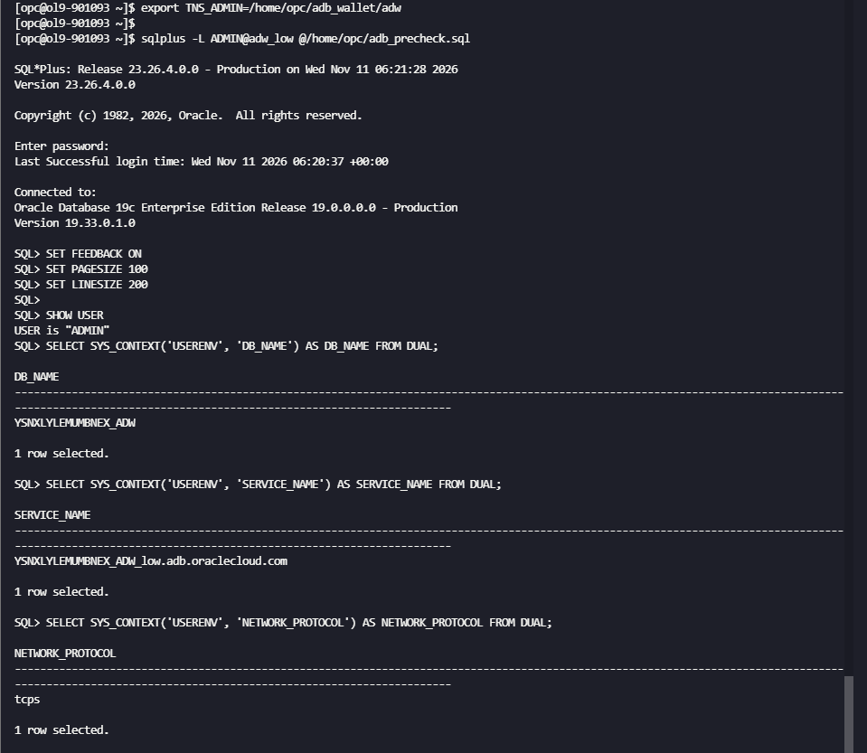

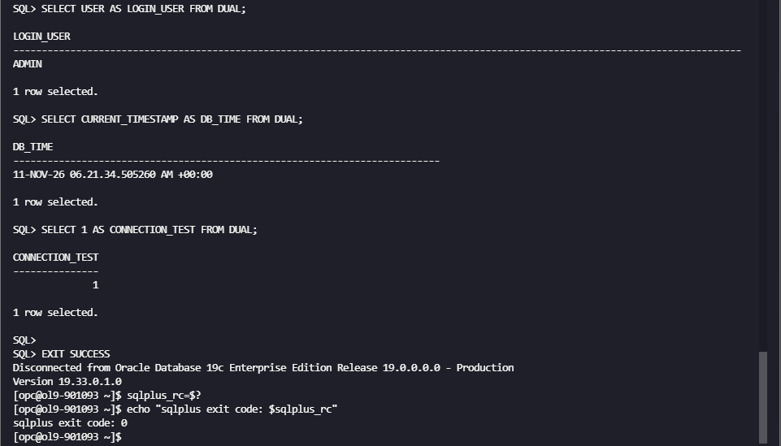

`0`이면 정상이다. 종료 코드는 `SQL>`가 아닌 Linux 셸 프롬프트에서 확인한다.

## 10. 오류 진단

| 증상/메시지 | 원인 | 조치 | 관련 문서 |
| --- | --- | --- | --- |
| `sqlplus: command not found` | 미설치/PATH | Instant Client와 SQL*Plus 설치, `command -v sqlplus` | — |
| `ORA-12154` | TNS Alias 미확인 | `TNS_ADMIN`, `tnsnames.ora`, Alias 철자 확인 | [Oracle ORA-12154](https://docs.oracle.com/error-help/db/ora-12154/) |
| `ORA-12541` | Listener/포트 도달 실패 | DNS, NSG, Security List, TCP 1522 확인 | [Oracle ORA-12541](https://docs.oracle.com/error-help/db/ora-12541/) |
| `ORA-12545` | 호스트/경로 오류 | Wallet HOST, DNS, 라우팅 확인 | [Oracle ORA-12545](https://docs.oracle.com/error-help/db/ora-12545/) |
| `ORA-28759` | Wallet 파일 열기 실패 | `TNS_ADMIN`, `sqlnet.ora`의 Wallet 경로, 필수 파일과 권한 확인 | [Oracle ORA-28759](https://docs.oracle.com/error-help/db/ora-28759/) |
| `ORA-29024` | 인증서 검증 실패 | Wallet 재다운로드, 서버 시간 확인 | [Oracle ORA-29024](https://docs.oracle.com/error-help/db/ora-29024/) |
| `ORA-01017` | 사용자/암호 오류 | DB 사용자 암호 확인, Wallet 암호와 구분 | [Oracle ORA-01017](https://docs.oracle.com/error-help/db/ora-01017/) |
| `ORA-28000` | 계정 잠김 | 관리자에게 계정 잠금 해제 요청 | [Oracle ORA-28000](https://docs.oracle.com/error-help/db/ora-28000/) |
| `ORA-01031` | 권한 부족 | 쓰기 검증 생략 또는 승인된 사용자·스키마 사용 | [Oracle ORA-01031](https://docs.oracle.com/error-help/db/ora-01031/) |
| 종료 코드 `127` | Linux 셸에서 명령을 찾지 못함 | SQL 프롬프트가 아닌 셸 프롬프트에서 명령과 PATH 확인 | — |

## 11. 공식 참고 문서

- [Oracle — Connect SQL*Plus with a Wallet (mTLS)](https://docs.oracle.com/en/cloud/paas/autonomous-database/serverless/adbsb/connect-sqlplus.html)
- [Oracle — Configure Network Access with Private Endpoints](https://docs.oracle.com/en-us/iaas/autonomous-database-serverless/doc/private-endpoints-autonomous.html)
- [Oracle — Install Oracle Instant Client Using RPMs](https://docs.oracle.com/en/database/oracle/oracle-database/26/lacli/install-instant-client-using-rpm.html)
- [Oracle — Use DNF on Oracle Linux](https://docs.oracle.com/en/learn/ol-dnf/)
