
[haksuperman-oci.site](https://haksuperman-oci.site) -> [www.haksuperman-oci.site](https://www.haksuperman-oci.site)
- DNS Zone이 아닌 Load Balancer에서 구현한 방법으로, 이외 다양한 방법이 존재할 수 있습니다. 
(Hostname을 통해 Listener를 분기시켜, www가 포함된 Listner로 리다이렉션 시키는 방법) 
- 모든 환경(웹 페이지, 도메인)은 테스트로 구성된 환경입니다.


## 1. Solution

### 1.1. 구성 흐름 (www 없이 접속)

1. ‘www가 포함되는 Listener’와 ‘www가 포함되지 않는 Listener’를 Hostname을 통해 구분

2. ‘www가 포함되지 않는 Listener’로 접속할 경우, ‘www가 포함되는 Listener’로 리다이렉션
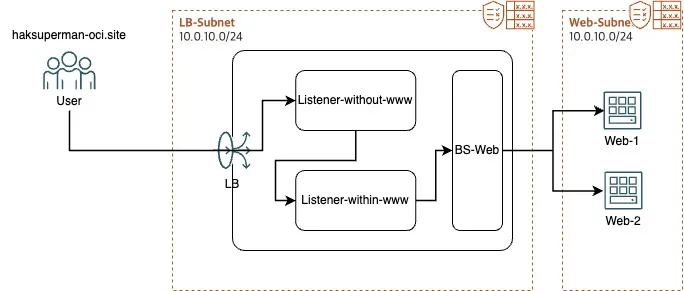

### 1.2. 구성 흐름 (www 포함해 접속)

‘www가 포함되는 Listener’로 접속할 경우, 별도 설정 없이 Backend set으로 포워딩
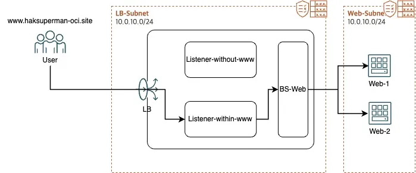

## 2. 설정

### 2.1. Hostname 생성

1. Listener 분기의 기준으로 사용될 Hostname 생성  
ex) [haksuperman-oci.site,](https://haksuperman-oci.site,) [www.haksuperman-oci.site](https://www.haksuperman-oci.site)
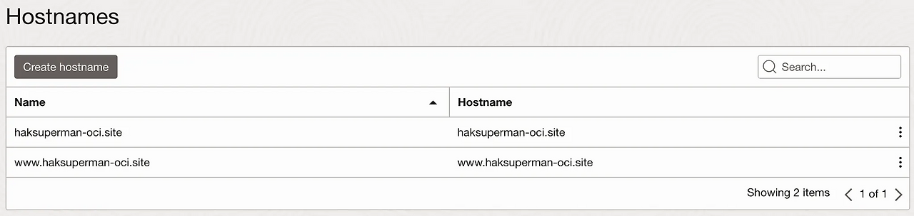

### 2.2. www용 Listener 생성 및 Hostname 지정

1. Name : \<적절한 이름 입력>
2. Protocol : HTTPS
3. Port : 443
4. Certificate : 미리 등록한 SSL 인증서 선택
5. Hostnames : 위에서 생성한 www가 붙은 Hostname 선택
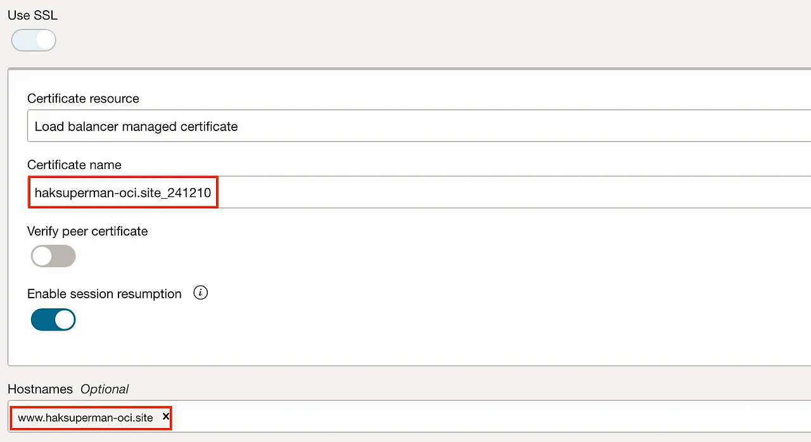

6. Backend set : Web 서버가 포함된 BS 선택
7. Listener 생성 확인
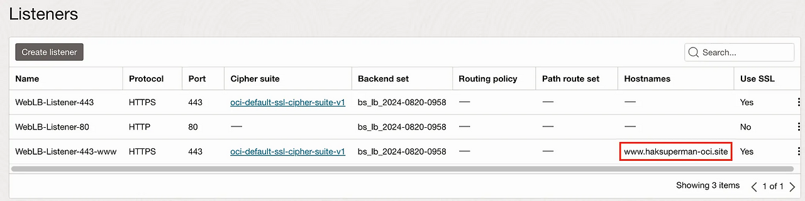

### 2.3. Ruleset 생성

1. Name : \<적절한 이름 입력>
2. Specify URL redirect rules 선택
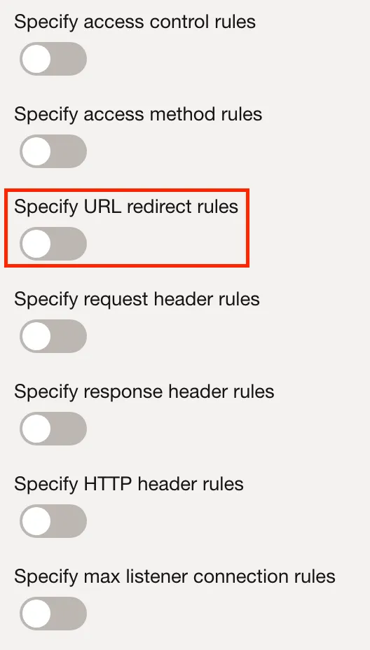

3. Source Path : / (모든 경로) ex) /video → haksuperman-oci.site/video
4. Match type : Prefix match 선택
- Force longest prefix match : 시스템은 들어오는 URL 경로의 시작 부분과 가장 길고 가장 잘 일치하는 규칙 경로 문자열을 탐색
- Exact match : 들어오는 URL 경로는 지정된 경로 문자열과 정확히 일치
- Prefix match : 들어오는 URL의 시작 부분은 지정된 경로 문자열과 정확히 일치
- Suffix match : 들어오는 URL의 끝 부분은 지정된 경로 문자열과 정확히 일치
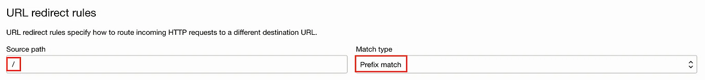

5. Redirect to:
Host : [www.haksuperman-oci.site](https://www.haksuperman-oci.site) 입력
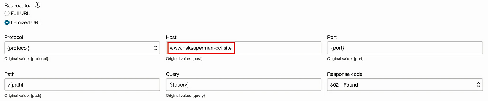

### 2.4. Ruleset 및 Hostname 적용

1. Ruleset 적용
- www가 포함되지 않은 Listener에 적용
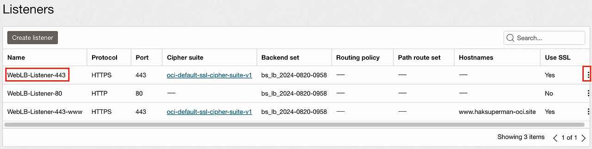

- 위에서 생성한 Ruleset 적용
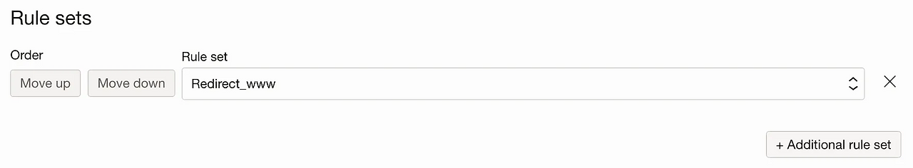

2. Hostname 적용 (생략 가능 → 443리스너들 간의 분기가 있을 때에는 Hostname을 지정하는 것이 권장 사항)
- www가 포함되지 않는 Listener에 적용

- www가 포함되지 않는 Hostname 적용
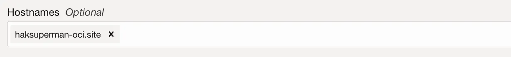

## 3. 결과

### 3.1. 적용 전

### 3.2. 적용 후
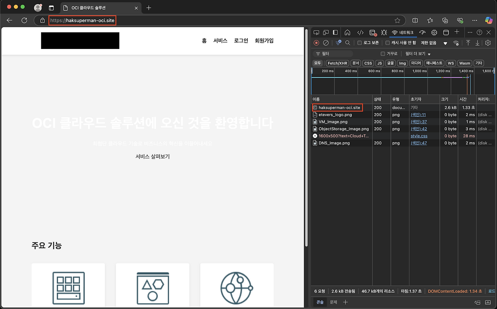
