> [!NOTE] 이번 실습의 목표 
> Apple Silicon Mac mini에 Hermes Agent를 Docker로 설치하고 ChatGPT Plus의 Codex OAuth를 연결한다. Discord 서버 Hermes-Agent의 #01\_atlas 채널에서 Bot Atlas의 기본 응답을 검증한다. Atlas의 총괄 비서 역할과 행동 원칙은 Part 2에서 구성하고, 추가 비서와 업무는 필요에 따라 별도 글에서 다룬다.

---

## 1. 구축 개요 및 설계 선택

### 1.1 아키텍처

```txt
Mac mini (macOS / Apple Silicon)
└─ Docker Desktop
   └─ Docker Compose: hermes-agent
      └─ Hermes 컨테이너: hermes-agent
         ├─ 공통 Gateway (default에서 실행)
         ├─ atlas Profile / Atlas 메인 비서
         ├─ ChatGPT Plus → Codex OAuth
         ├─ Terminal Backend: local (컨테이너 내부 명령 실행)
         ├─ /opt/data            ← Docker Named Volume
         ├─ /knowledge/wiki      ← Mac wiki/ 폴더
         ├─ /workspace           ← Mac workspace/ 폴더
         └─ /outputs             ← Mac outputs/ 폴더
                  ↕
Discord: Hermes-Agent 서버 → #01_atlas 채널 → Atlas Bot
```

### 1.2 공식 예제와 이번 구성의 차이

- 공식 Docker Quick Start 및 M1 Mac 블로그: 호스트 `~/.hermes`를 컨테이너 `/opt/data`에 연결하는 **Bind Mount** 방식.
- 이번 구성: Hermes 상태·세션 DB는 **Docker Named Volume**에 저장하고, Wiki·작업 파일·결과물은 **Mac Bind Mount**로 관리한다.
- 이유: Docker Desktop의 macOS 공유 파일시스템(virtiofs)에서는 SQLite WAL의 동시 접근에 제약이 있다. Hermes v2026.9.14 이후 신규 DB는 이를 감지해 DELETE 저널로 생성하지만, Named Volume은 Linux 네이티브 저장소에서 WAL을 사용할 수 있다. **Bind Mount가 잘못된 것이 아니라 두 방식의 운영 특성이 다른 것**이다.
- Docker에서 **Hermes 자체를 실행**하는 것과 `terminal.backend=docker`로 **추가 Docker Sandbox를 만드는 것**은 다른 개념이다. 이번 실습의 `terminal.backend=local`은 macOS가 아닌 **Hermes 컨테이너 내부**에서 실행한다.
- 이번에는 Gateway API(8642)와 Dashboard(9119) 포트를 노출하지 않는다. Discord Bot 연결에는 불필요하다.
- 처음부터 `atlas` Profile을 생성해 Atlas Bot을 연결한다. `default`는 공통 Gateway를 실행하는 관리 기준으로 두고, Atlas의 설정·SOUL·세션은 `/opt/data/profiles/atlas`에 저장한다. 추후 비서도 각 Profile과 전용 Bot으로 추가한다.

### 1.3 참고 문서

- [Hermes 공식 Docker 문서](https://hermes-agent.nousresearch.com/docs/user-guide/docker)
- [Hermes Quickstart](https://hermes-agent.nousresearch.com/docs/getting-started/quickstart)
- [Hermes Configuration](https://hermes-agent.nousresearch.com/docs/user-guide/configuration)
- [Hermes Discord 연동](https://hermes-agent.nousresearch.com/docs/user-guide/messaging/discord)
- [Hermes LLM Wiki Skill](https://hermes-agent.nousresearch.com/docs/user-guide/skills/bundled/research/research-llm-wiki)
- [Hermes CLI 명령어](https://hermes-agent.nousresearch.com/docs/reference/cli-commands)
- [Tense Movement: M1 Mac Docker 설치](https://tensemovement.com/blog/2026-07-14-01-docker-setup-m1)

## 2. 사전 환경 점검

**대상 환경:** Apple Silicon Mac mini, Docker Desktop 설치, macOS 터미널(zsh) 사용. 별도 VPS/네이티브 Hermes 설치 없음.

```bash
sw_vers
uname -m
docker --version
docker compose version
docker info --format 'OS: {{.OperatingSystem}} / Architecture: {{.Architecture}}'
docker context ls
```

**확인 포인트:** `arm64`, Docker Engine 연결 가능, 활성 컨텍스트 `desktop-linux` 등. Engine 소켓 연결 실패 시 Docker Desktop을 실행한 후 재확인한다.

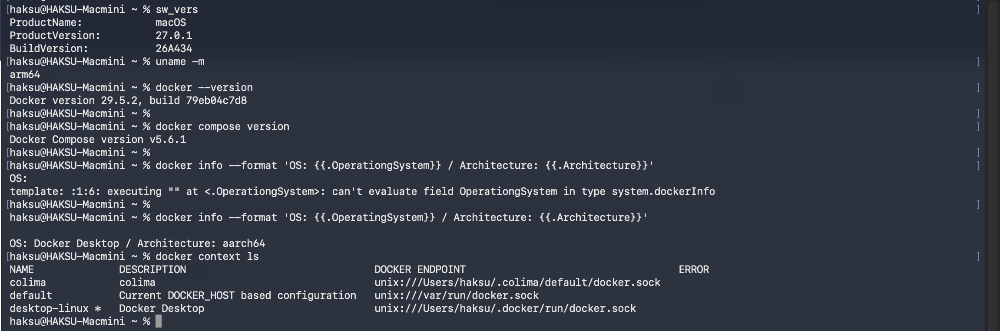

## 3. 프로젝트 경로 및 폴더 생성

이번 프로젝트 루트는 **`$HOME/Projects/hermes-agent`로** 고정한다.

```bash
mkdir -p "$HOME/Projects/hermes-agent"/{wiki,workspace,outputs,backups}
chmod 700 "$HOME/Projects/hermes-agent/backups"
cd "$HOME/Projects/hermes-agent"
pwd
ls -la
```

```txt
~/Projects/hermes-agent/
├── compose.yaml       # Docker 실행 선언
├── wiki/              # Markdown 기반 LLM Wiki
├── workspace/         # AI 파일·코드 작업 공간
├── outputs/           # 생성 결과물
└── backups/           # 백업 아카이브 보관
```

설정, OAuth 토큰, 메모리, 세션 및 `state.db`는 이 폴더가 아닌 **Docker Named Volume의 `/opt/data`에** 저장한다.

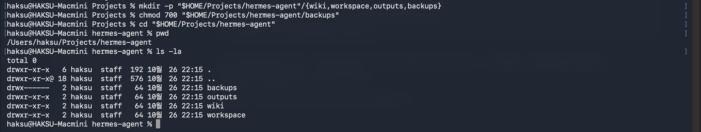

## 4. Docker Compose 작성

`compose.yaml`이 없는 경우 아래 명령으로 생성한다. **기존 파일이 있다면 실행 전 내용을 확인하고 백업한다.**

```bash
cd "$HOME/Projects/hermes-agent"

cat > compose.yaml <<'YAML'
name: hermes-agent

services:
  hermes:
    image: nousresearch/hermes-agent:stable
    container_name: hermes-agent
    restart: unless-stopped
    command: ["gateway", "run"]

    environment:
      WIKI_PATH: /knowledge/wiki
      TZ: Asia/Seoul

    volumes:
      # Hermes state: config, OAuth, sessions, SQLite, skills, memory
      - hermes-data:/opt/data

      # Mac에서 열어볼 지식 및 산출물
      - ./wiki:/knowledge/wiki:rw
      - ./workspace:/workspace:rw
      - ./outputs:/outputs:rw

    mem_limit: 4g
    cpus: 2.0
    shm_size: "1gb"

volumes:
  hermes-data:
YAML
```

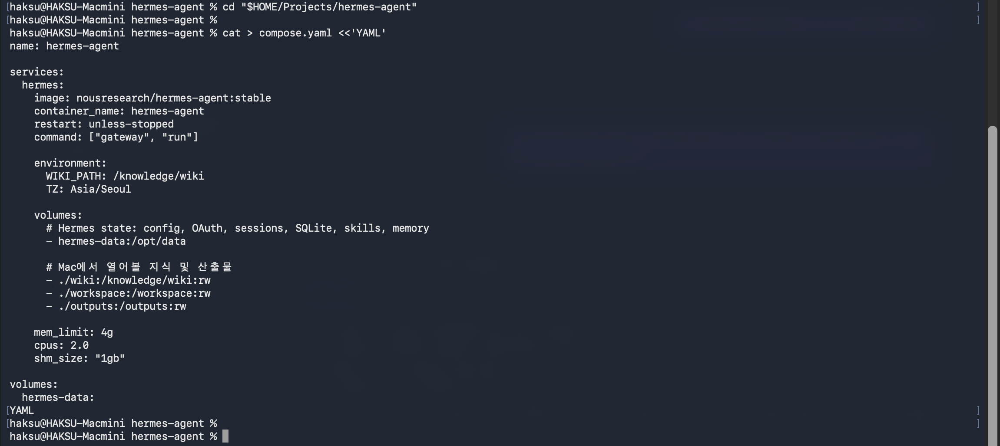

### 주요 설정과 이유

- `name: hermes-agent`: Docker Compose 프로젝트 이름을 고정한다.
- `TZ: Asia/Seoul`: 컨테이너의 날짜 명령과 로그를 한국 시간 기준으로 맞춘다. Hermes 자체의 시간대 설정은 이후 문서에서 다룬다.
- `stable`: 안정 릴리스 채널. 재현성 확보가 중요해지면 특정 버전 또는 이미지 digest로 고정한다.
- `restart: unless-stopped`: Docker 엔진 재시작 후 컨테이너 재개. 단, macOS 부팅 후 사용자 로그인·Docker Desktop 실행 조건은 별도 점검한다.
- `hermes-data:/opt/data`: SQLite와 인증정보를 Linux VM의 볼륨에 보관한다.
- `./wiki`, `./workspace`, `./outputs`: Mac에서 직접 읽고 편집할 데이터만 폴더 공유한다.
- `mem_limit`, `cpus`, `shm_size`: 초기 자원 제한 및 향후 브라우저 자동화를 위한 공유 메모리 설정.
- **생략한 항목:** `ports`, `privileged`, Docker Socket 마운트, Mac `$HOME` 전체 마운트. 외부 API 접근과 macOS 제어 권한을 최소화한다.

> [!WARNING] **보안 주의**
> Hermes 컨테이너 안에서 실행되는 Shell은 컨테이너 내부의 OAuth 설정 파일 및 쓰기 가능 마운트에 접근할 수 있다. 이 초기 구성은 Mac 전체 접근을 줄이지만, 컨테이너 내부 코드 실행을 별도의 Sandbox로 다시 격리하지는 않는다. 신뢰할 수 없는 코드를 자율 실행하기 전에 전용 실행 계층을 추가한다.

```bash
docker compose config --quiet
docker compose pull
docker compose run --rm hermes --version
docker images nousresearch/hermes-agent
docker volume ls --filter 'name=hermes-agent'
```

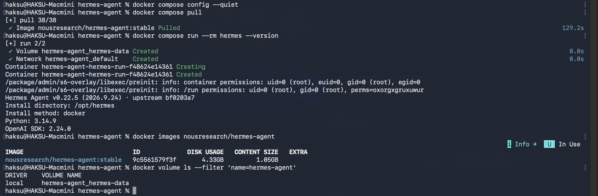

`docker compose pull` 도중 `unexpected EOF` 발생 시 이미지 다운로드를 다시 시도한다. 버전 확인 명령이 성공해도 모델 인증은 아직 끝난 것이 아니다.

## 5. Atlas Profile 생성과 Setup Wizard

```bash
cd "$HOME/Projects/hermes-agent"

# 아직 상시 컨테이너가 없으므로, 두 초기화 명령만 임시 컨테이너로 실행한다.
docker compose run --rm hermes -p default config set gateway.multiplex_profiles true
docker compose run --rm hermes profile create atlas --no-alias

# 새 공통 Gateway를 상시 컨테이너로 실행한다.
docker compose up -d
docker compose ps
docker compose exec -T --user 10000:10000 hermes hermes -p atlas gateway status
```

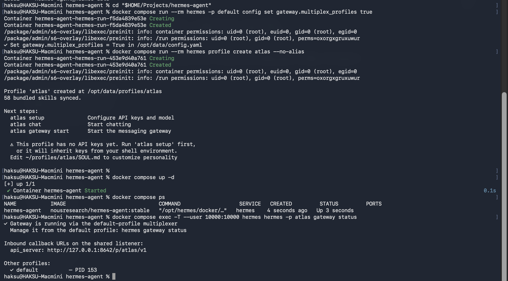

이 단계에서 **새 default 설정과 atlas Profile을 만들고, 새 공통 Gateway를 처음 시작**한다. `default`는 공통 실행·관리 기준이며 Discord Bot 토큰을 등록하지 않는다. 비서의 설정·인증·SOUL은 `atlas`에 둔다. [공식 Profiles](https://hermes-agent.nousresearch.com/docs/user-guide/profiles)

`gateway status`에서 `Gateway is running via the default-profile multiplexer`를 확인한다. 시작 직후 준비 중이면 잠시 후 **status 명령만** 다시 실행한다. 확인 전에는 다음 단계로 넘어가지 않는다. 여기서 running은 Gateway 실행 확인이며 AI 모델 인증 성공을 뜻하지 않는다.

준비되면 **동일한 상시 컨테이너 안에서** Atlas 설정을 연다.

```bash
docker compose exec -it --user 10000:10000 hermes hermes -p atlas setup
```

이후 설정·모델·Bot 연결·대화는 모두 `exec`를 사용한다. `-p atlas`는 작업할 Profile을 지정한다. `atlas`를 위한 별도 Gateway 설치·실행은 하지 않는다. [공식 Docker 런타임](https://hermes-agent.nousresearch.com/docs/user-guide/docker), [공식 공통 Gateway](https://hermes-agent.nousresearch.com/docs/user-guide/multi-profile-gateways)

**초기 선택 원칙**

- Quick Setup 선택
  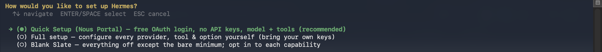
- 모델은 6절에서 ChatGPT Codex OAuth로 연결한다. Nous Portal은 사용하지 않는다. 모델 선택이 나오면 ChatGPT/Codex 구독 경로를 선택하고, Portal 로그인 화면으로 들어갔다면 취소해 돌아온다. Setup 자체가 종료돼도 아래 terminal 설정과 6절의 모델 연결을 순서대로 진행한다.
- Terminal Backend: `local` 선택. **컨테이너 내부** 명령 실행이다.
  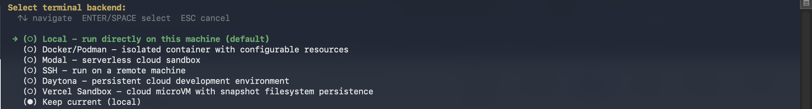
- Messaging: 이번에는 건너뛰고 모델 응답 검증 후 7절에서 Discord를 설정한다. 별도 Gateway 서비스 설치·자동 시작을 제안하면 건너뛴다. Docker Compose가 공통 Gateway를 관리한다.
  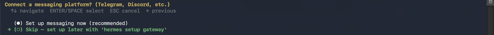
- Telemetry 및 Agent 기본 설정: 원하는 개인정보 설정을 확인하고 기본값에서 시작한다.
  ```bash
  docker compose exec -T --user 10000:10000 hermes hermes -p atlas config get terminal.backend
  # docker로 선택되어 있으면 local로 변경
  docker compose exec -T --user 10000:10000 hermes hermes -p atlas config set terminal.backend local
  docker compose exec -T --user 10000:10000 hermes hermes -p atlas config get terminal.backend
  ```

  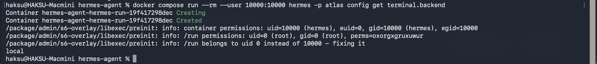

  **정상 결과:** `local`. Atlas 설정은 새 볼륨의 `/opt/data/profiles/atlas/config.yaml`에 저장된다. `atlas`가 이미 있다는 오류가 나면 초기화 완료 여부를 확인하며, 그 상태에서 기존 설정을 재사용하지 않는다.

## 6. ChatGPT Plus OAuth / Codex 모델 연결

이번 실습은 **ChatGPT Plus 계정의 Codex OAuth**만 사용하며 별도 Nous Portal 구독이나 OpenAI API Key를 발급하지 않는다.

```bash
docker compose exec -it --user 10000:10000 hermes hermes -p atlas model
```

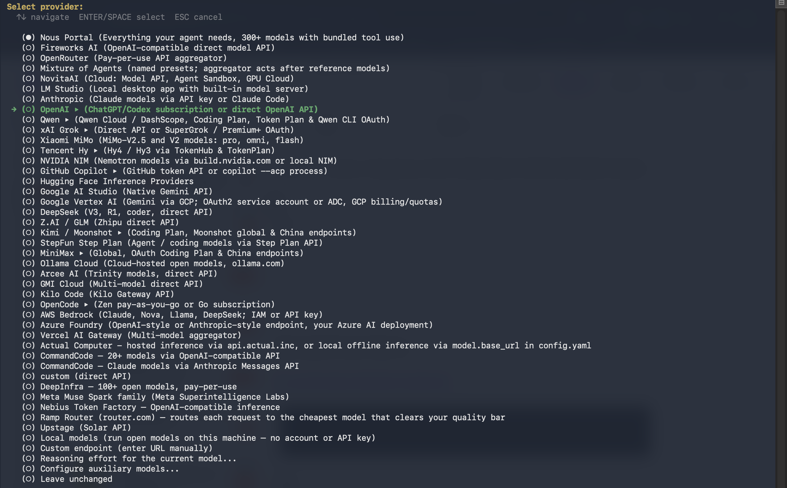

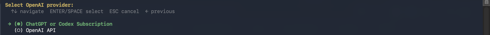

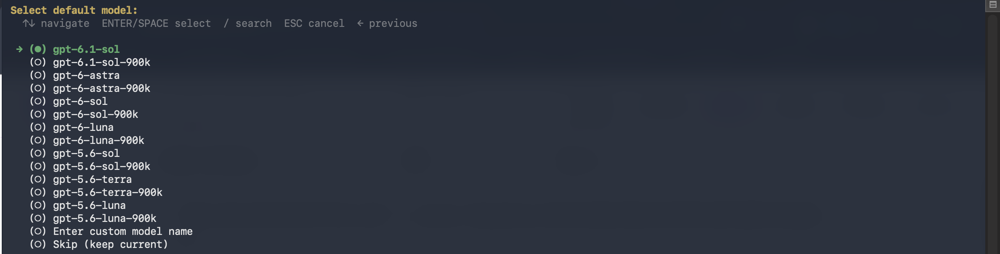

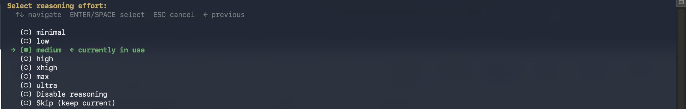

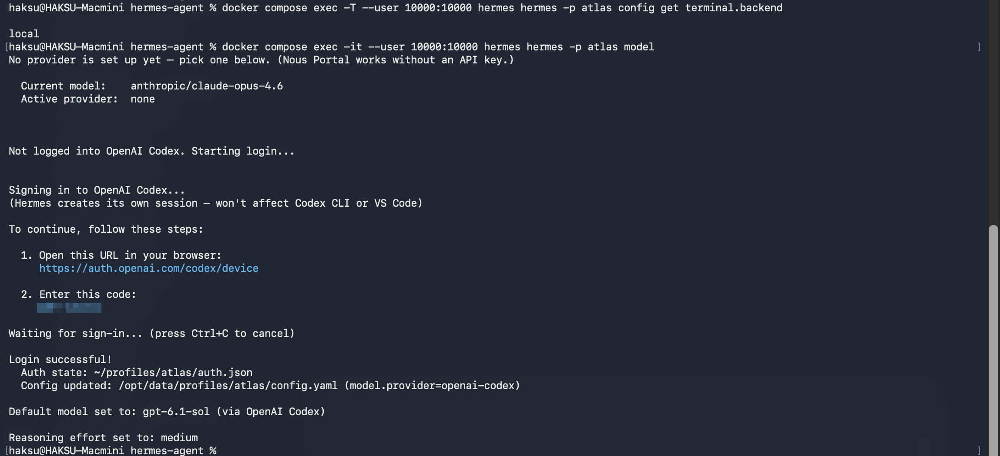

마법사에서 **ChatGPT or Codex Subscription** → 로그인 안내에 따라 ChatGPT Plus 계정 인증 → 실제 제공되는 Codex 모델 중 메인 모델 선택 → Reasoning Medium 선택

> [!NOTE] **구독 관련 주의** 
> OAuth 로그인에 성공하더라도 Hermes의 사용 가능량·호출 제한은 계정 및 공급자 정책에 따라 달라질 수 있다.

이번에는 저장된 기존 인증을 전제로 하지 않고 **atlas에서 새 Codex OAuth 로그인을 완료**한다. 모델 화면을 마치면 아래 순서로 재시작해 새 모델·인증 설정을 반영하고, 같은 상시 컨테이너에서 AI 응답을 확인한다. 아직 Discord를 연결하지 않아도 이 시험은 가능하다.

```bash
cd "$HOME/Projects/hermes-agent"
docker compose restart hermes
docker compose exec -T --user 10000:10000 hermes hermes -p atlas config get model.provider
docker compose exec -T --user 10000:10000 hermes hermes -p atlas gateway status
docker compose exec -T --user 10000:10000 hermes hermes -p atlas chat --oneshot -q "도구를 실행하지 말고, 한국어로 정상 연결되었다고 한 문장으로 답해줘."
```

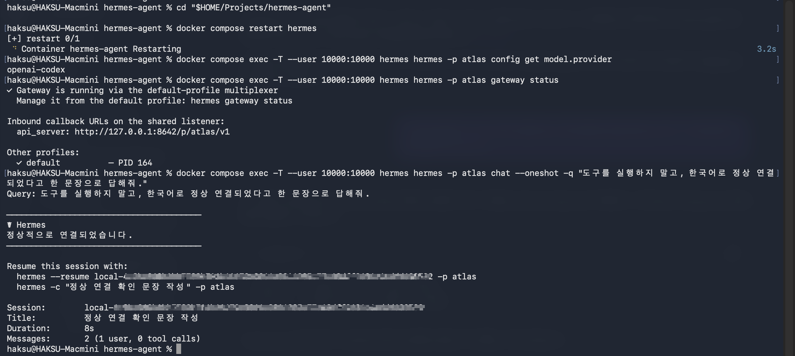

**통과 기준:** 공급자가 `openai-codex`이고, 공통 Gateway 실행 상태가 확인되며, 마지막 명령에 실제 한국어 답변이 나온다. 재시작 직후 준비 중이면 status를 다시 확인한 뒤 대화 명령을 실행한다. 이 결과를 캡처한 다음 7절로 간다. 실패하면 9절에서 Gateway 연결 오류와 인증 오류를 구분해 확인한다. 

## 7. Discord 서버와 Atlas Bot 생성

**논리 구조**

```txt
Discord Server: Hermes-Agent
└─ Channel: #01_atlas
   └─ Discord Bot: Atlas
      └─ Hermes Profile: atlas (Atlas 전용 설정·SOUL·기억)

공통 실행 구조
Hermes 컨테이너: hermes-agent
└─ 공통 Gateway (default Profile에서 실행·관리)
   └─ atlas Profile의 Atlas Bot 연결 처리
```

`default`는 공통 Gateway를 실행·관리하는 Profile로 유지한다. Atlas와 대화할 때 사용하는 Profile은 `atlas`다. 

### 7.1 Discord 서버

Discord에서 `Hermes-Agent` 서버를 만들고 `#01_atlas` 텍스트 채널을 생성한다.

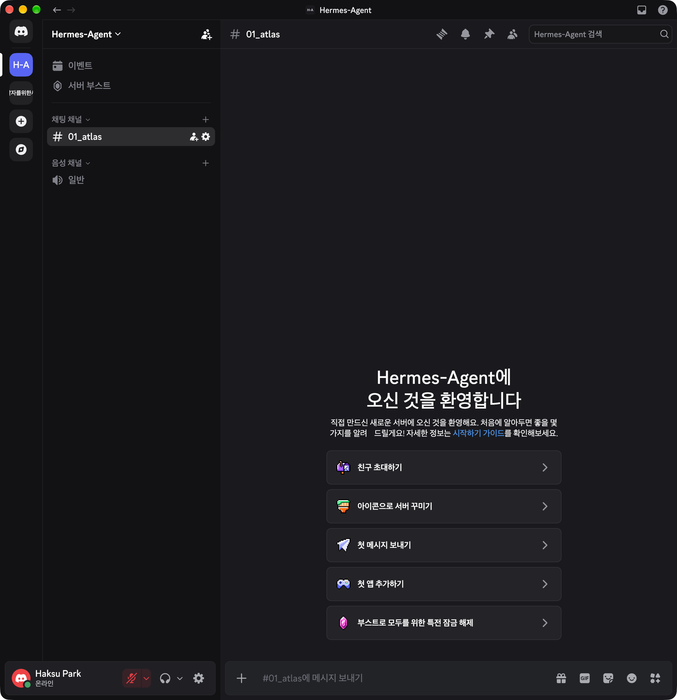

### 7.2 Discord Developer Portal

[Discord Developer Portal](https://discord.com/developers/applications)에서 **New Application → Atlas** 생성.

1. Bot 탭
   - Bot 탭의 Bot 사용자 이름을 **Atlas**로 설정한다.
     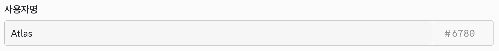
   - **Message Content Intent**를 활성화한다. Hermes 공식 Discord 가이드에서는 **Server Members Intent도 필수(Required)로** 안내한다. 사용자명 조회 및 허용 사용자 식별에 사용되므로 **Message Content Intent와 함께 활성화**한다.
     
   - 토큰 초기화를 클릭해 Bot의 Token을 안전하게 기록한다.
2. OAuth2 탭
   - OAuth2 URL 재생기 항목의 스코프에서 applications.commands와 bot을 체크한다.
     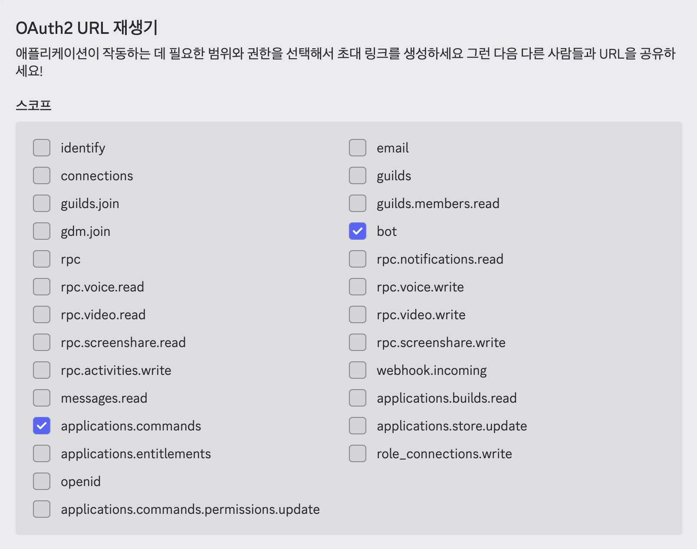
   - Bot 권한은 채널 보기, 메시지 보내기, 링크 임베드, 파일 첨부, 메시지 기록 보기 등 필요한 항목 위주로 부여한다. 관리자 권한을 주지 않는다.
     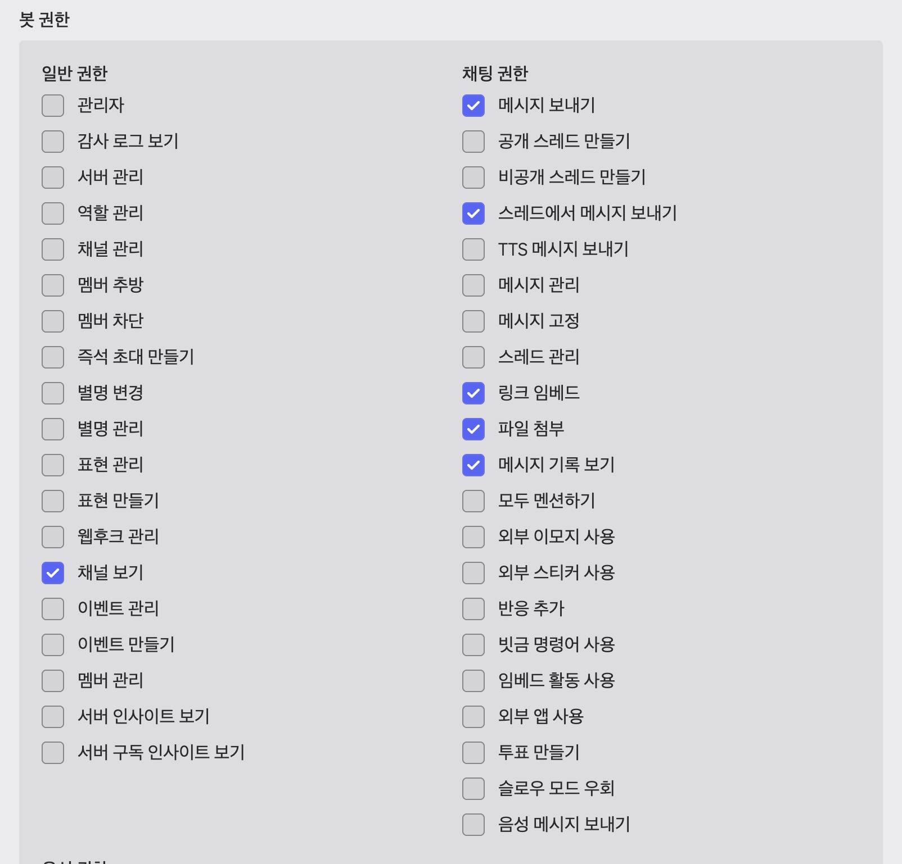
3. 봇-서버 연결
   - 하단 생성된 URL 브라우저 접속 → 위에서 생성한 서버 연결 및 승인
     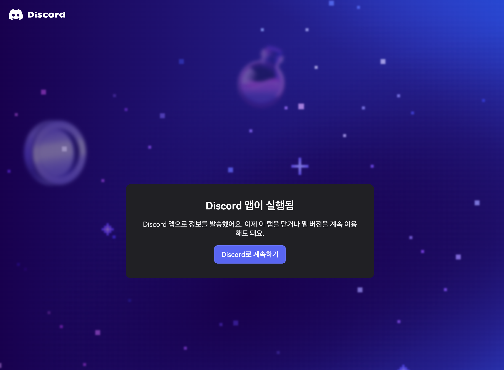

     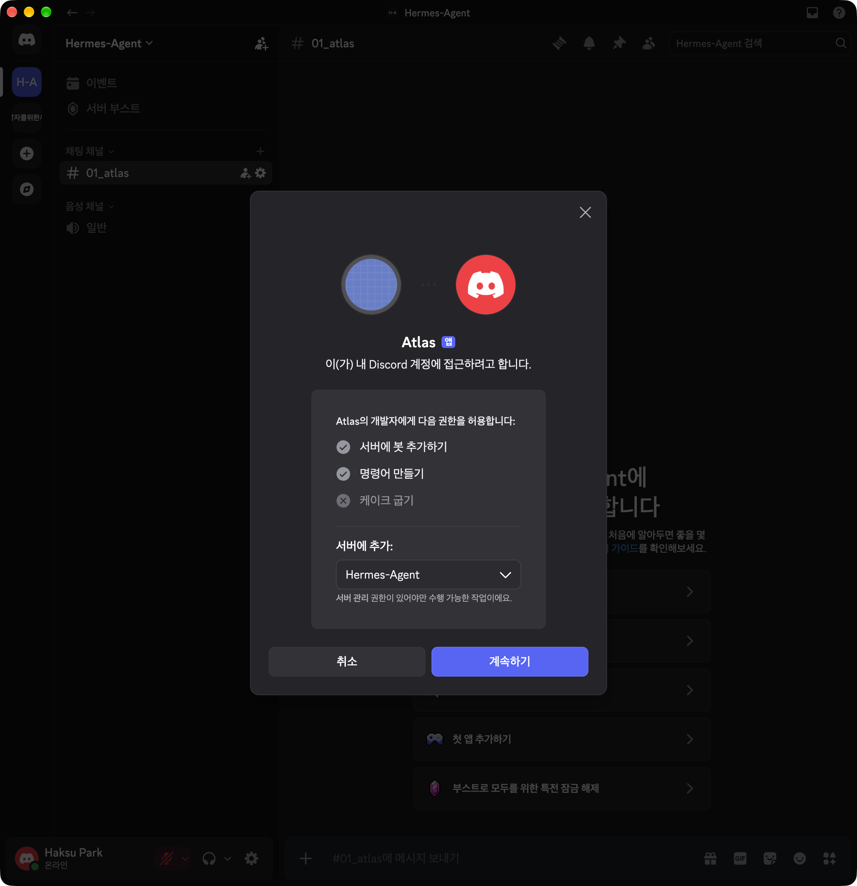

     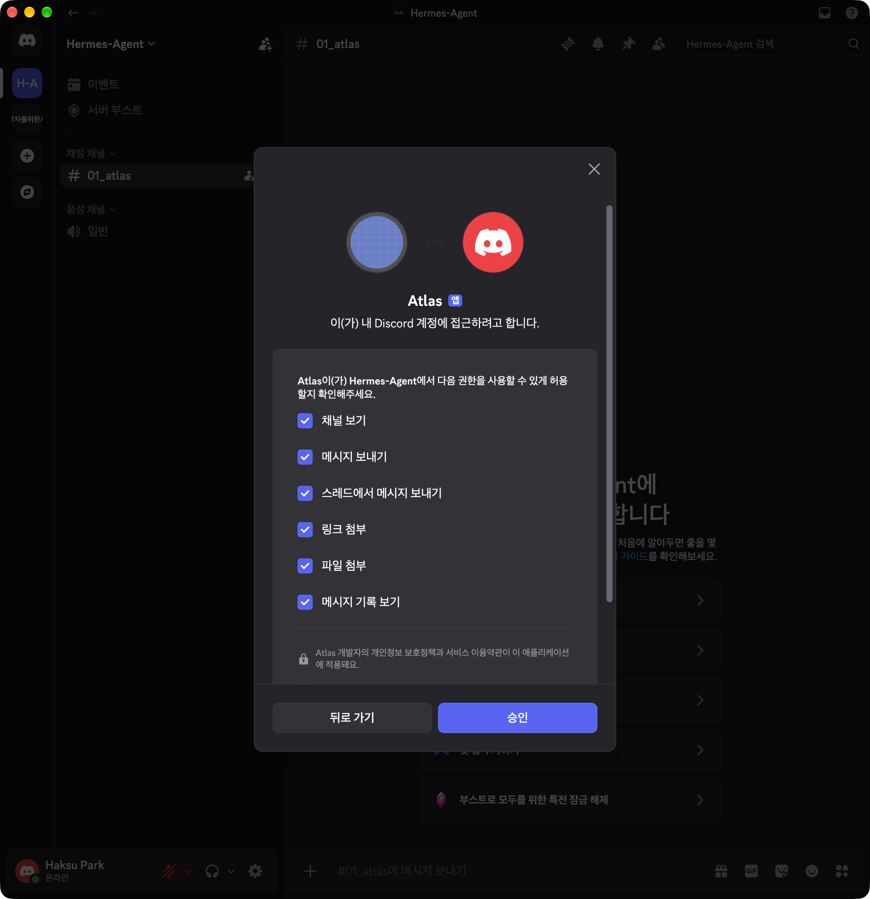

### 7.3 Hermes 연결

```bash
docker compose exec -it --user 10000:10000 hermes hermes -p atlas gateway setup
```

Discord 선택 → 봇 토큰 입력 → Bot 소유자/사용자 허용 설정(Y → Skip) → Home channel ID 입력 → 초대 링크 확인

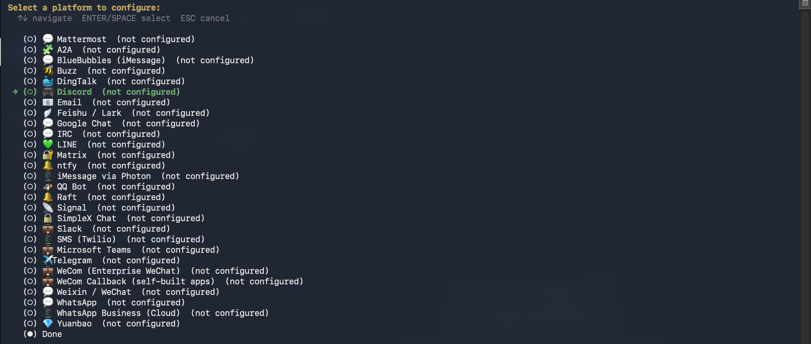

**이 단계에는 Atlas Bot의 토큰을 입력한다.** 토큰과 허용 사용자 설정은 `atlas` Profile에 저장된다. 다른 비서를 만들 때는 해당 Profile의 설정 화면에 그 비서 Bot의 별도 토큰을 입력한다. 같은 토큰을 여러 Profile에 복사하지 않는다.

**본인 Discord 계정만 Allowlist**로 허용하며 전체 사용자 허용 옵션을 사용하지 않는다.

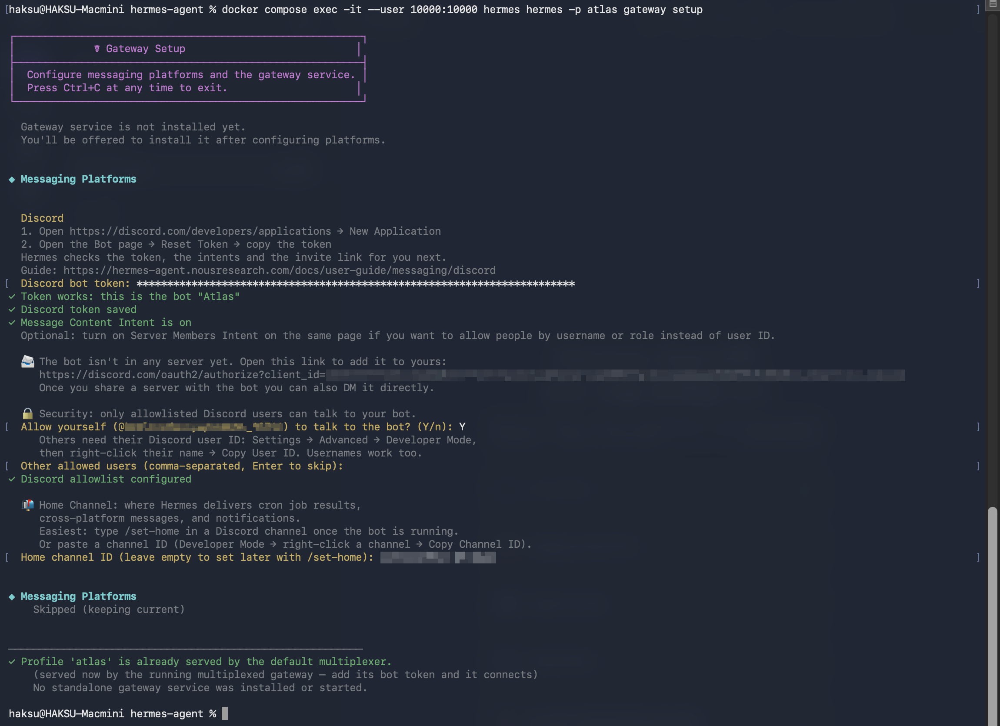

채널에 직접 응답하도록 자동 스레드 생성도 끈다. Discord의 스레드 권한과 이 설정은 별개다.

```bash
docker compose exec -T --user 10000:10000 hermes hermes -p atlas config set discord.auto_thread false
docker compose exec -T --user 10000:10000 hermes hermes -p atlas config set discord.free_response_auto_thread false
```

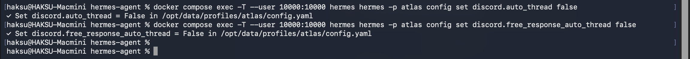

## 8. Discord 설정 반영과 Gateway 상태 확인

5절에서 새로 시작한 상시 컨테이너에 7절에서 처음 등록한 Atlas Bot 설정을 반영하도록 재시작한다. 별도 Profile Gateway나 컨테이너를 추가로 실행하지 않는다.

```bash
cd "$HOME/Projects/hermes-agent"
docker compose restart hermes
docker compose ps
docker compose exec -T --user 10000:10000 hermes hermes -p atlas gateway status
docker compose logs --tail=100 hermes
```

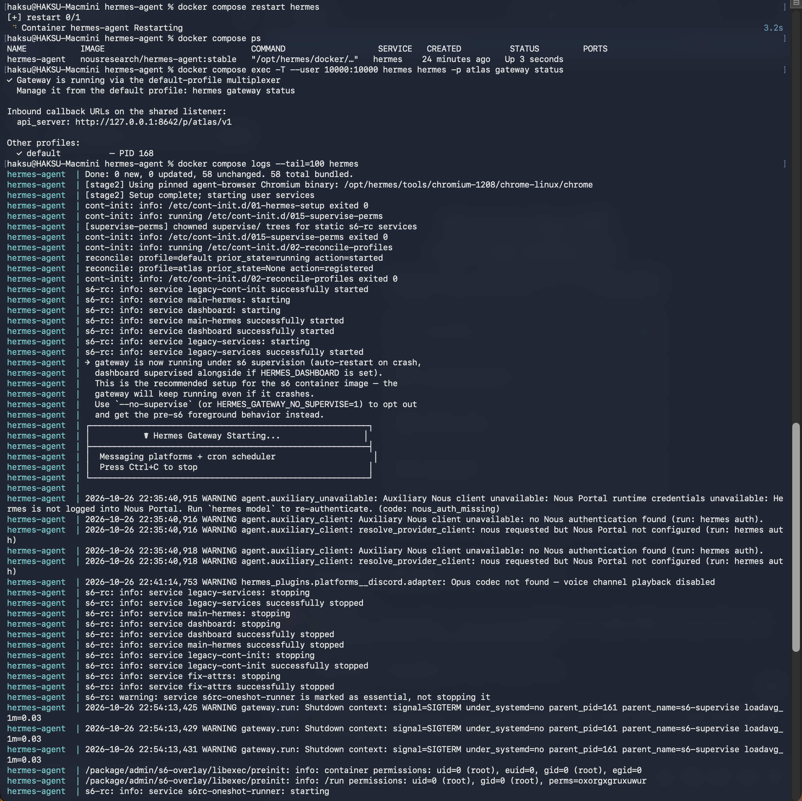

공통 Gateway 하나가 Profile별 Bot을 연결한다. Compose의 `command: ["gateway", "run"]`은 그대로 두고, Atlas만을 위한 별도 Gateway나 컨테이너는 시작하지 않는다.

```bash
docker compose exec -T --user 10000:10000 hermes hermes profile list
docker compose exec -T --user 10000:10000 hermes hermes -p atlas gateway status
```

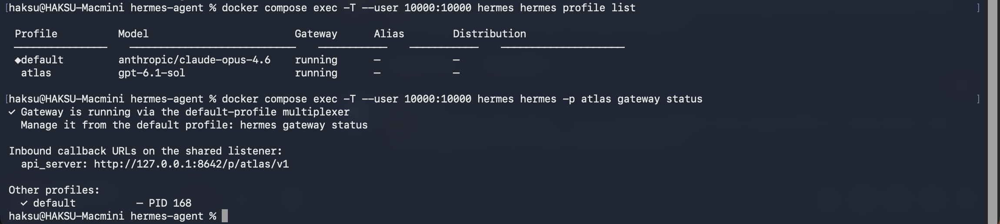

`atlas`가 공통 Gateway에서 서비스되는지 확인하고, 아래 Discord 응답까지 확인한다. [공식 다중 Profile Gateway](https://hermes-agent.nousresearch.com/docs/user-guide/multi-profile-gateways)

### 8.1 Hermes Doctor 환경 점검

Hermes 설치 및 설정을 완료한 후 `doctor` 명령어로 인증, 구성 파일, SQLite DB, Gateway, 도구 및 의존성 상태를 점검할 수 있다.

```bash
docker compose exec --user 10000:10000 hermes hermes -p atlas doctor
```

**점검 결과 해석:** `Found N issue(s)`가 출력되어도 반드시 Hermes 설치 실패를 의미하지는 않는다. 미사용 기능의 API Key 누락이나 의존성 취약점 경고일 수 있으므로 항목별 내용을 확인한다.

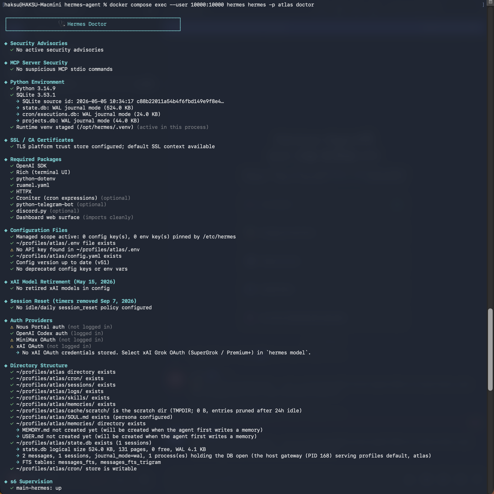

### 8.2 Discord 연결 검증

Discord `#01_atlas`에서 `@Atlas 안녕`을 입력하여 답변을 확인한다. 기본적으로 일반 서버 채널에서는 Bot을 멘션해야 하며, DM은 별도 멘션 없이 대화할 수 있다.

**설정: #01\_atlas 채널 멘션 없이 응답**  
Discord 개발자 모드에서 `#01_atlas`의 Channel ID를 복사하고 아래 `CHANNEL_ID`를 실제 값으로 변경한다.

```bash
docker compose exec --user 10000:10000 hermes hermes -p atlas config set discord.free_response_channels CHANNEL_ID
docker compose restart hermes
```

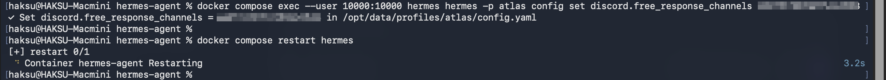

**확인:** `#01_atlas` 메시지에 멘션 없이 답변하는지 테스트.

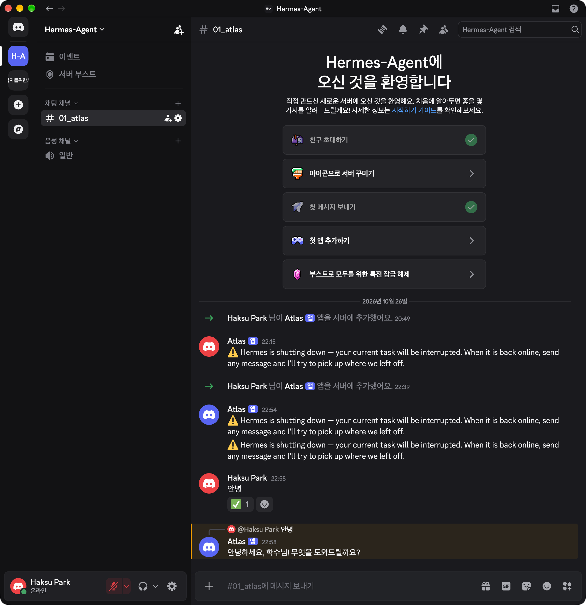

## 9. 설치 중 자주 발생하는 문제

- **`Profile 'atlas' does not get a gateway of its own`**: 이 구성은 default의 공통 Gateway 하나를 사용한다. 5절에서 상시 컨테이너의 Gateway를 먼저 시작한 뒤, `exec`로 atlas 설정·모델·Bot 연결을 진행했는지 확인한다. `hermes -p atlas gateway install`, `--force`, `gateway.standalone`으로 해결하지 않는다. 프로필용 별도 Gateway 설치와 Bot 토큰 등록은 다른 작업이다.
- **`Gateway connection failed; no local fallback`**: `docker compose run ... chat`는 별도 임시 컨테이너를 만들어 기존 Gateway에 연결하지 못할 수 있다. 5절에서 `docker compose up -d`로 상시 컨테이너를 실행한 뒤 `docker compose exec -T --user 10000:10000 hermes hermes -p atlas chat --oneshot -q "안녕"`으로 시험한다. 실패하면 먼저 같은 컨테이너의 `hermes -p atlas gateway status`를 확인한다. 이 오류만으로 OAuth 재로그인이나 Profile 재생성을 진행하지 않는다.
- **`Cannot connect to Docker daemon`**: Docker Desktop 실행 여부 및 `docker context ls` 확인.
- **`unexpected EOF`**: 이미지 다운로드 중 연결이 끊긴 경우 `docker compose pull` 재시도. 기존 데이터·볼륨을 삭제할 필요는 없다.
- **`hermes: 'version' is not a hermes command`**: `docker compose run --rm hermes --version`으로 확인한다. `version`은 하위 명령어가 아닌 옵션이다.
- **`No inference provider is configured`**: `docker compose exec -it --user 10000:10000 hermes hermes -p atlas model`에서 ChatGPT Codex OAuth 연결 상태 점검.
- **Terminal Backend가 `docker`여서 실행 실패**: 별도 Docker Sandbox가 없는 현재 구성에서는 `docker compose exec -T --user 10000:10000 hermes hermes -p atlas config set terminal.backend local`로 설정.
- **Discord Bot 무응답**: Gateway 로그·Bot Token·Message Content Intent·Server Members Intent·사용자 허용 목록·채널 권한·Bot 멘션을 확인한다.
- **Mac에서 `hermes` 명령을 찾을 수 없음**: 이번 설치는 호스트 네이티브가 아닌 Docker 방식이므로 `docker compose exec hermes hermes ...`를 사용한다.
- **`Found N issue(s)` (Doctor)**: 필수 연결 실패가 아닌 미사용 API Key·npm 의존성 경고도 포함될 수 있다. 경고별 의미를 확인하고 의존성 패치는 공식 수정 버전을 적용한다.
- **`docker compose down -v` 주의**: `hermes-data` Named Volume까지 삭제될 수 있어 실행 전 백업 여부를 확인한다.
