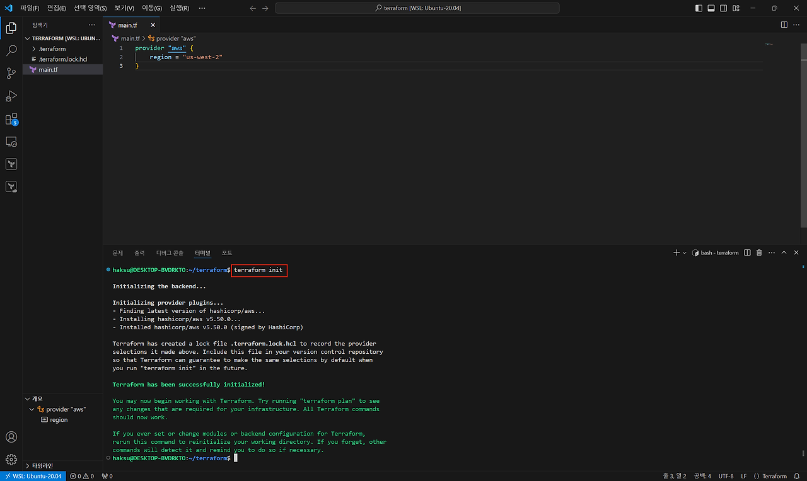
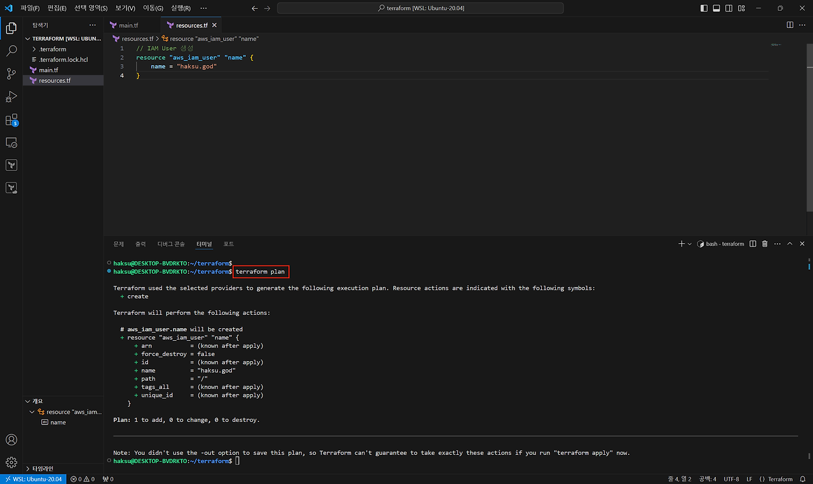
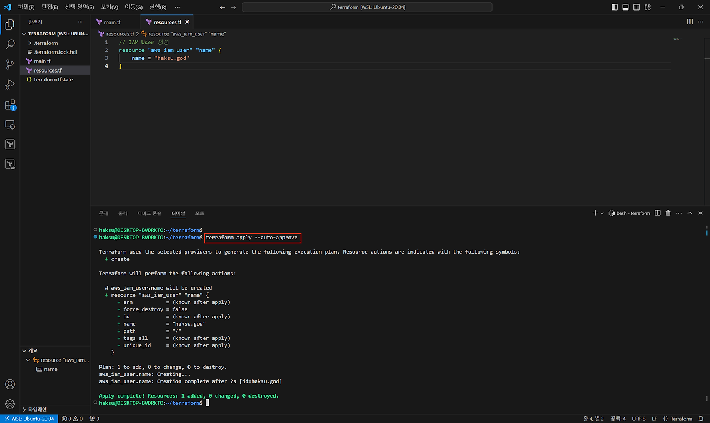
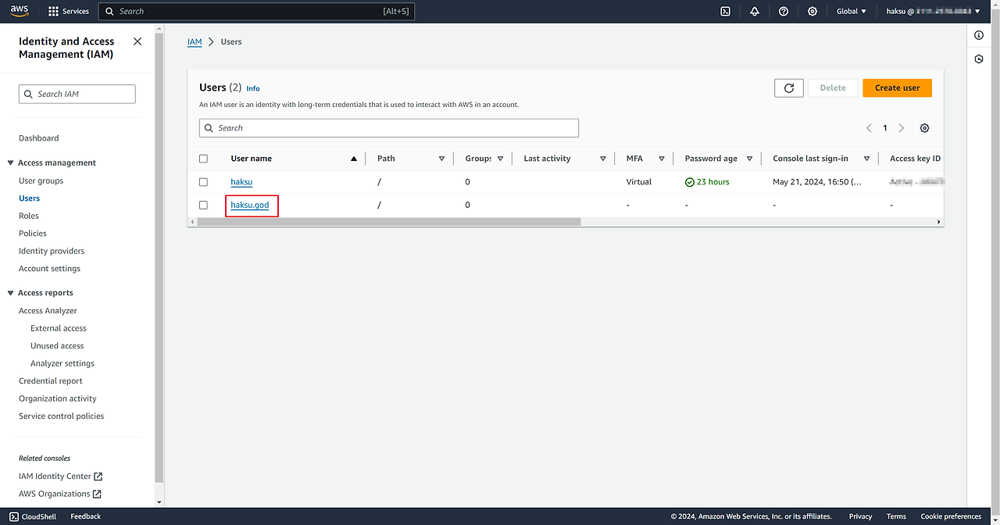
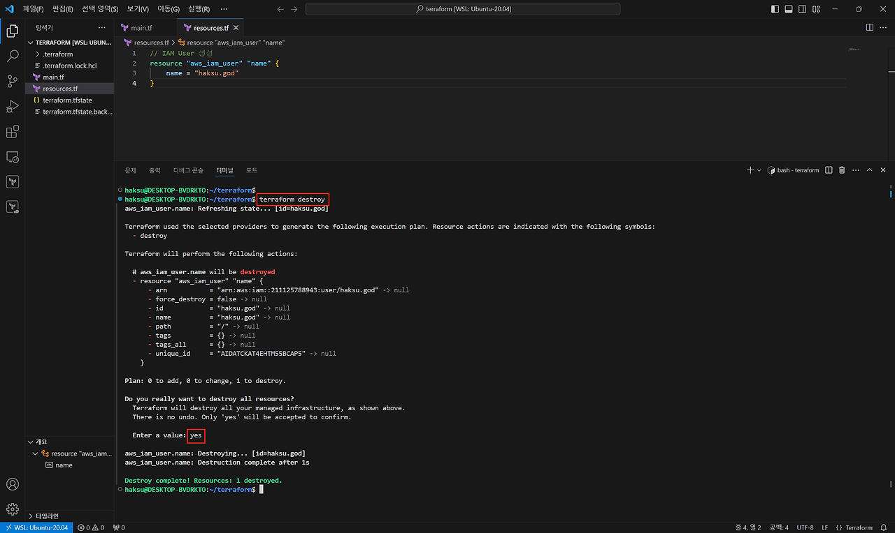
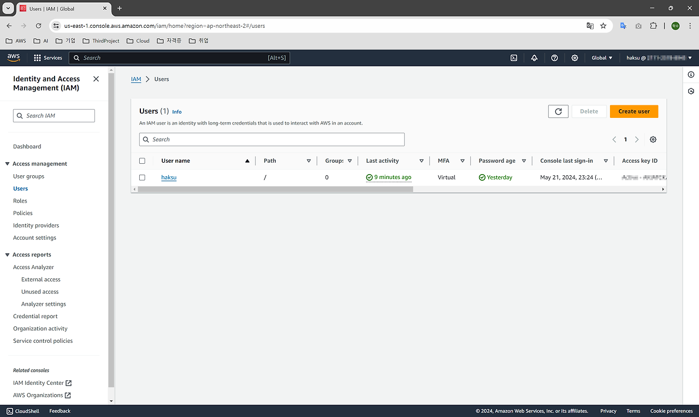

## 1. Terraform 기본 명령

| terraform <명령어> | 기능 |
| --- | --- |
| terraform init | 테라폼 초기화<br> - 백엔드 설정<br>     - 프로바이더 플러그인 설치<br>     - 모듈 다운로드<br>     - 환경 초기화 |
| terraform plan | dry-run(테스트)<br>     - 현재 상태 파일 확인<br>     - 설정 파일(.tf) 읽고 파싱<br>     - 현재 상태와 설정 파일의 상태 비교<br>     - 변경 사항 요약 출력<br> |
| terraform apply (auto-aprove) | 실제 적용<br>     - 현재 상태 파일 확인<br>     - 설정 파일(.tf) 읽고 파싱<br>     - 현재 상태와 설정 파일의 상태 비교<br>     - **인프라 변경 사항을 클라우드 제공 업체에 반영**<br>     - (auto-aprove 옵션은 진행 자동 승인)<br> |
| terraform destroy (auto-aprove)<br> | 삭제<br>     - 현재 상태 파일 확인<br>     - 설정 파일(.tf) 읽고 파싱<br>     - 현재 상태와 설정 파일의 상태를 비교<br>     - **인프라의 모든 리소스를 클라우드 제공업체에서 삭제**<br>     - (auto-aprove 옵션은 진행 자동 승인) |

## 2. AWS API와 상호 작용하기 위한 프로바이더 선언(terraform init)

### main.tf

```terraform
provider "aws" {
	region  = "us-west-2"
}
```


```bash
terraform init
```

## 3. IAM User 생성(terraform plan, terraform apply)

### resources.tf
1. 작성한 코드 dry-run(테스트)
```terraform
// IAM User 생성
resource "aws_iam_user" "name" {
    name = "haksu.god"
}
```


    ```bash
    terraform plan
    ```

2. 실제 적용

```bash
terraform apply --auto-approve
```

3. 실제 적용된 것 확인


## 4. IAM User 삭제(terraform destroy)
1. terraform destroy


    ```bash
    terraform destroy
    \--auto-approve 명령을 빼고 진행하면 진행할건지 묻는 과정을 거쳐야 함
    ```

CI/CD나 스크립트를 작성해서 자동화를 진행할 때에는 `--auto-approve` 명령이 유용하다!!


2. 삭제된 것 확인

