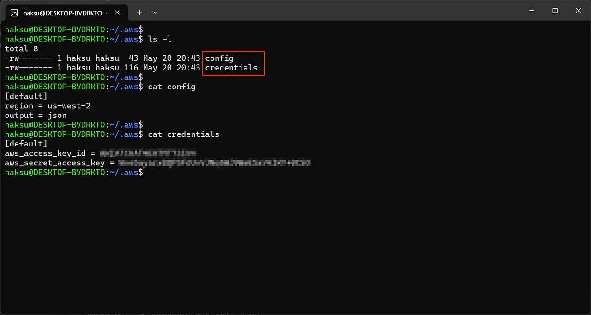
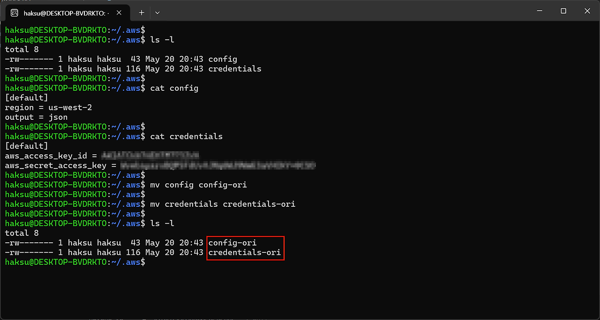
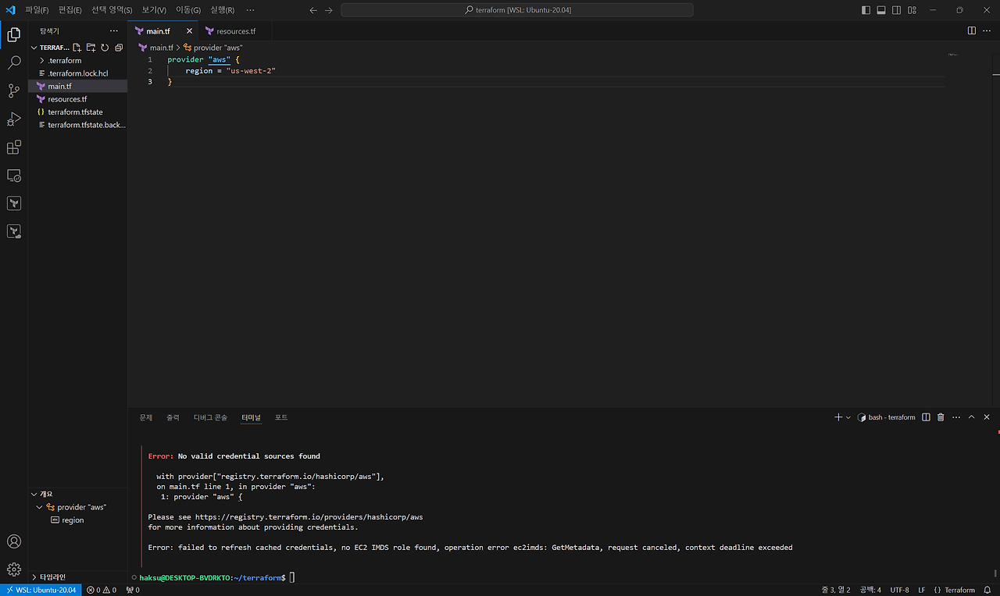
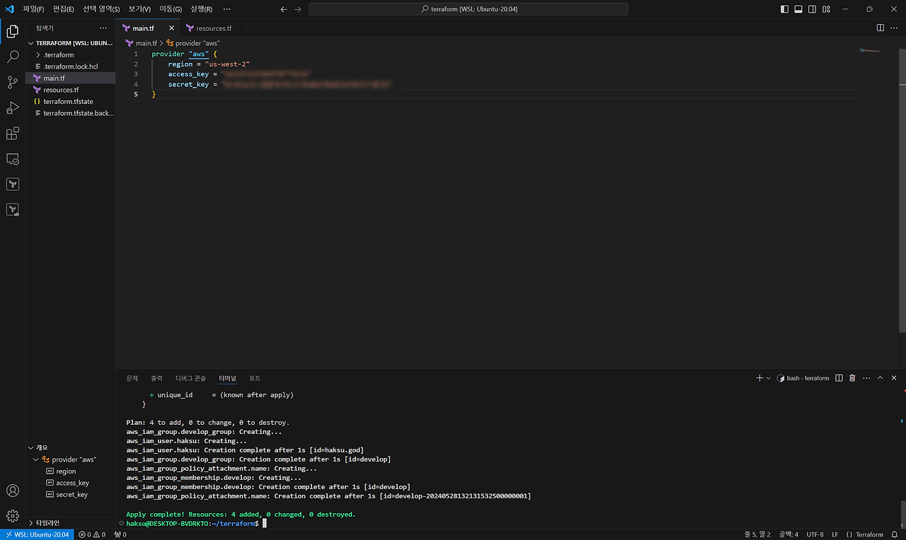
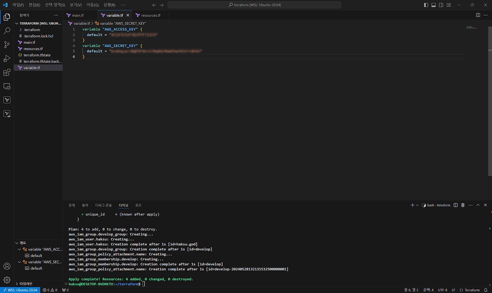
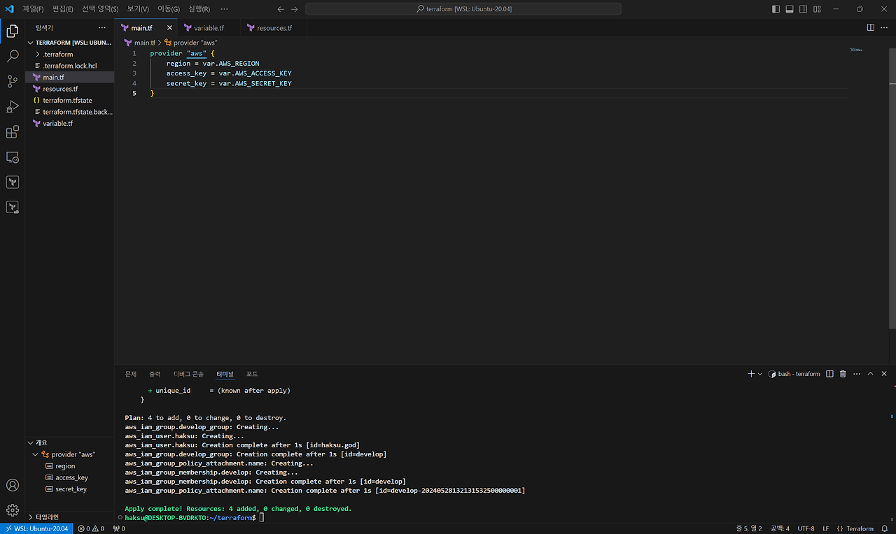
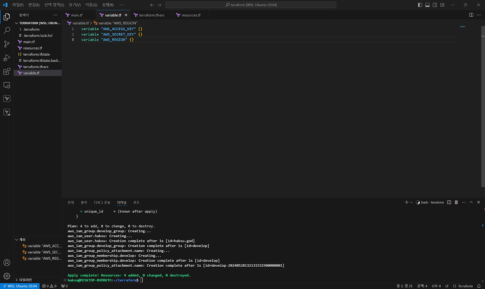
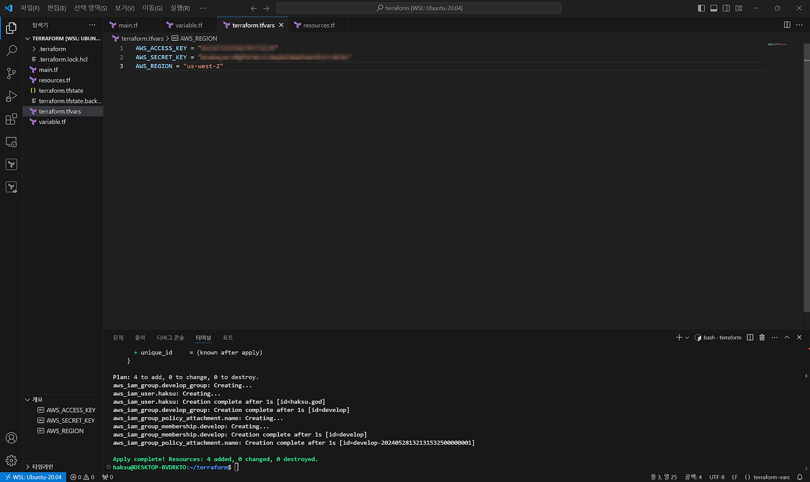
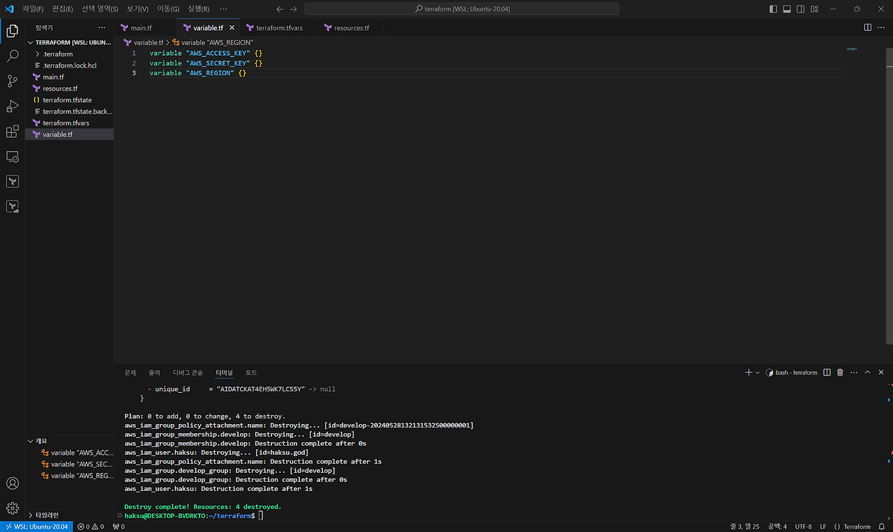

[[Terraform] 테라폼 동작을 위한 사전 준비 (with. AWS Credentials, IAM 등)]()


## 1. terraform.tfvars의 필요성

1. 기존에는 AWS에 계정 인증을 aws configure 명령을 통해 진행했었다. **~/.aws/config** 파일과 **~/.aws/credentials** 파일을 통해 확인할 수 있었다.


2. 이 파일들이 손상된다면 AWS와의 계정 인증을 통해 코드형 인프라 작업을 할 수 없을까?


3. 예상한대로 credentials 에러로 실패한다.


#### 1) provider 블럭에 포함시키는 방법
main.tf 파일에 직접 프로바이더 블록에 입력해주는 방법이 있다. 하지만 코드 그대로 Access key와 Secret key가 입력되기 때문에 GitHub와 같은 Repository에 올릴 수 없다.


#### 2) variable.tf 파일에 변수를 등록시켜 입력하는 방법

1. variable.tf
    ```terraform
    variable "AWS_ACCESS_KEY" {
    default = "[access key]"
    }
    variable "AWS_SECRET_KEY" {
    default = "[secret key]"
    }
    ```


2. main.tf
    ```terraform
    provider "aws" {
        region = "us-west-2"
        access_key = variable.AWS_ACCESS_KEY
        secret_key = variable.AWS_SECRET_KEY
    }
    ```


3. 이렇게 변수를 만들어 변수의 값만 저장하는 variable.tf 파일을 이용하면 어떨까?<br>
결국 이렇게 다른 변수들과 같이 사용하면 provider에 바로 입력하는 것처럼 무의미할 것이다.


## 2. terraform.tfvars

1. variable.tf
    ```terraform
    variable "AWS_ACCESS_KEY" {}
    variable "AWS_SECRET_KEY" {}
    variable "AWS_REGION" {}
    ```


2. terraform.tfvars

    ```terraform
    AWS_ACCESS_KEY = "[access key]"
    AWS_SECRET_KEY = "[secret key]"
    AWS_REGION = "[region]"
    ```


3. variable.tf 파일에는 변수를 정의하고, terraform.tfvars 파일에 해당 변수들의 값만 따로 저장시키는 방법이 있다.<br>
\-> 이런 방법이 따로 있는게 아닌 **꼭 이렇게 해야 함**!!

4. 작업도 잘 된다.

